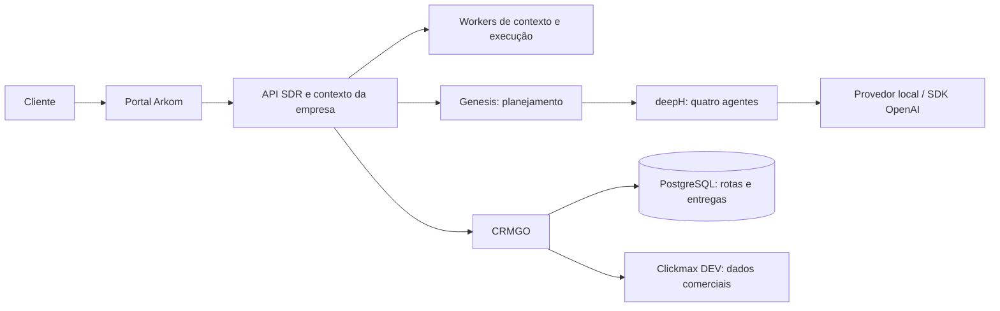

# ArkomGO

Plataforma agêntica da Arkom: o cliente descreve o que precisa, trabalha com agentes e ferramentas dentro da plataforma e acompanha as decisões com o contexto da sua empresa.

Este repositório reúne o **estado de desenvolvimento de 13/11/2026** do portal, SDR, CRM, deepH e backend em refatoração. A demo executa atendimento com IA e integra o CRM ao Clickmax de desenvolvimento. O Genesis coordena quatro agentes e já prepara alterações limitadas de qualificação SDR/CRM: gera e testa um artefato Go, oferece uma prévia e publica a regra no motor existente após aprovação. O estúdio de construção agora também coordena escrita de código Go e interface web, testes isolados e traces persistidos. Implantação e integração automática das aplicações geradas ainda estão no roteiro.

## Comece por aqui

- [Genesis Flutter e eventos em tempo real](apps/genesis_flutter/README.md)
- [SDR Arkom existente e interface para o Lovable](docs/SDR-PRODUTO-E-LOVABLE.md)
- [Backend isolado da prévia Genesis](docs/GENESIS-RUNTIME-PREVIA.md)
- [Construção por etapas e traces](docs/GENESIS-PASSO-A-PASSO.md)
- [Persistência mínima de dados da aplicação](docs/GENESIS-DADOS-APLICACAO.md)
- [Contrato versionado das aplicações geradas](docs/GENESIS-CONTRATO-APLICACAO.md)
- [Estúdio de construção: código, Gophers e traces](docs/GENESIS-CONSTRUCAO.md)
- [Primeira etapa agêntica: regra SDR/CRM em Go](docs/GENESIS-ETAPA-1.md)
- [Estrutura e responsabilidades](docs/ARQUITETURA.md)
- [Como preparar e executar a demo](docs/EXECUTAR.md)
- [Catálogo completo de diagramas Mermaid](docs/mermaid/README.md)
- [O que funciona e próximas etapas](docs/STATUS-E-ROADMAP.md)
- [Verificações desta publicação](docs/VALIDACAO.md)
- [Origem dos componentes](docs/source-manifest.json)

## Organização

| Pasta | Responsabilidade |
| --- | --- |
| `apps/genesis_flutter` | Plataforma Flutter: navegação, Início com squads, negócio, ferramentas, CRM, Luma e Genesis |
| `apps/agents/bia` | Interfaces da BIA e da Lia em React/Vite, abertas no Flutter |
| `services/sdr` | Servidor web Go, proxy local, API, contexto da empresa, atendimento, sessões, automações, aprovações, workers e ponte Genesis |
| `services/crm` | CRMGO: contatos, funis e oportunidades; roteamento por empresa e integração Clickmax |
| `services/core` | Backend Arkom/Bia em refatoração, diretório, identidade, barramento e integrações |
| `packages/deeph` | Runtime Go de orquestração de agentes |
| `services/sdr/pkg/sdrsdk` | Contratos e clientes usados pelos workers do SDR |
| `services/sdr/demo/deeph` | Configuração dos agentes de planejamento Genesis |
| `docs/mermaid` | Diagramas editáveis e catálogo dos diagramas existentes nos componentes |
| `scripts` | Preparação e execução local; geração do catálogo de diagramas |

A árvore é uma consolidação de fontes, com módulos Go e aplicações Node independentes. Não é necessário iniciar `services/core` para abrir a demo integrada. Os repositórios de origem permanecem independentes e estão identificados no manifesto.

## Validação

A integração original foi verificada por TypeScript, testes Go e consultas reais ao ambiente DEV. Há testes de sessão compartilhada, navegação Flutter, passagem de sessão aos agentes e restrição do proxy Go local. Testes HTTP não comprovam o comportamento completo da interface; confira os comandos de validação local na documentação.

Consulte [EXECUTAR](docs/EXECUTAR.md) para requisitos, configuração e comandos. Credenciais, bancos, conversas, logs e arquivos de execução não fazem parte desta publicação. O modo simplificado da demo é exclusivo do ambiente local.

A [plataforma local](docs/ECOSISTEMA-LOCAL-FLUTTER.md) usa Flutter no catálogo, detalhes, CRM, CLIPS e Genesis. O SDR abre seu cliente completo existente, preparado para o Lovable, em React; a migração dele precisa preservar suas funções. Soluções ainda sem backend nesta estrutura ficam bloqueadas no catálogo.

A plataforma não depende de Next.js. O Go serve o Flutter compilado diretamente. `/demo` abre o time como **Início**; a logo Arkom abre a **Visão geral** em `/demo/home`. Os frontends próprios da BIA, Lia, Maia e FinanceAI são superfícies de agentes incorporadas, com sessão vinculada à empresa.

A agente **Lia** reutiliza a agenda nativa Go já existente e seu worker isolado. O acesso pelo time e pela BIA usa as mesmas agendas da empresa, com aprovações e regras próprias. Veja [integração da Lia](docs/ECOSISTEMA-LOCAL-FLUTTER.md#lia--agenda).
