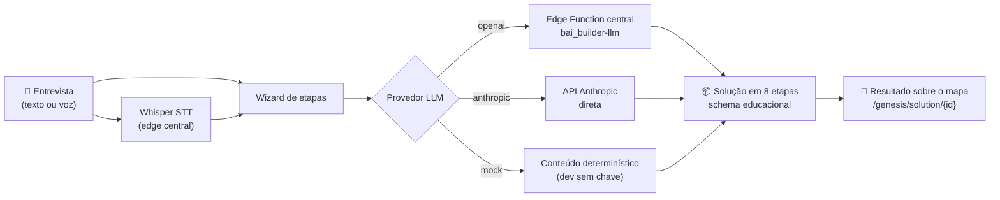
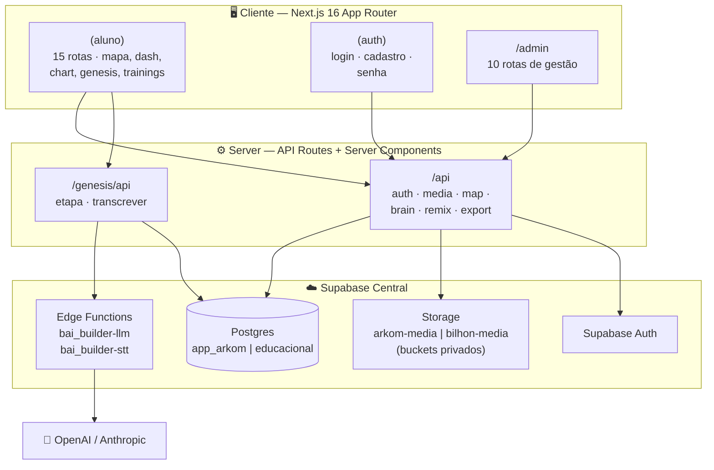

<div align="center">

# A R K O M

### A superfície visual de operação de uma força de trabalho de IA

*Um mapa vivo de 137 funções em 7 departamentos — navegável, ensinável e acompanhável.*

<br/>


<br/>

**240 arquivos TS/TSX · ~54.000 linhas · 99 componentes · 24 rotas · 8 APIs · 8 migrations**

</div>

---

## 📖 Índice

- [O que é o Arkom](#-o-que-é-o-arkom)
- [Conceitos fundamentais](#-conceitos-fundamentais)
- [Mapa da aplicação](#-mapa-da-aplicação)
- [Genesis — o builder de soluções por IA](#-genesis--o-builder-de-soluções-por-ia)
- [Arquitetura](#-arquitetura)
- [Design system](#-design-system)
- [Backend e dados](#-backend-e-dados)
- [Segurança](#-segurança)
- [Stack completa](#-stack-completa)
- [Rodando local](#-rodando-local)
- [Qualidade e testes](#-qualidade-e-testes)
- [Deploy](#-deploy)
- [Estrutura do projeto](#-estrutura-do-projeto)

---

## 🧭 O que é o Arkom

Toda empresa tem um **catálogo de trabalho que pode ser feito por IA** — do totalmente autônomo ao conduzido por humano. O Arkom torna esse catálogo **navegável como um mapa espacial**, ensina como construir cada peça e acompanha o que já está no ar.

Em vez de uma lista de ferramentas, você navega um universo:

- 🌌 Um **mapa radial** com 7 departamentos orbitando a Base de Conhecimento
- 📊 **Centrais de comando** com KPIs reais em coverflow
- 📈 Uma **matriz de rollout** dos 137 jobs por estágio e nível de autonomia
- 🧠 Um **segundo cérebro** que dá contexto a cada agente
- ⚡ O **Genesis** — um builder que gera soluções de IA completas por entrevista
- 🎓 **Trainings** — trilha de capacitações com aulas em vídeo, progresso por aluno e espaço de networking
- 🛠️ Um **painel admin completo** para gerir alunos, convites, conteúdo, mídia e mentorias

---

## 💡 Conceitos fundamentais

| Conceito | O que significa |
|---|---|
| **Node Zero — Base de Conhecimento** | O centro do mapa. Os arquivos de contexto da empresa (quem é, o que vende, como fala) que **todo agente lê antes de trabalhar**. Nada roda bem sem ele. |
| **Departamentos → funções → skills** | 7 departamentos (Sales, Deals, Marketing, Operations, Intelligence, Customer, Back office), cada um com funções, cada função com jobs, cada job com skills executáveis (`SKILL.md`). |
| **Níveis de autonomia** | Cada job é classificado como *conduzido por humano*, *assistido por humano* ou *totalmente autônomo* — a espinha dorsal da matriz de rollout. |
| **Escada manual → autônomo** | Cada job tem um caminho de evolução: por que ele ainda é humano hoje e o que falta para subir de nível. |

---

## 🗺️ Mapa da aplicação

A aplicação é dividida em **três superfícies**: a área do aluno, a autenticação e o painel administrativo.

### Área do aluno — `(aluno)`

| Rota | Experiência |
|---|---|
| `/home` | Página inicial **reativa ao banco** — dados reais do aluno: progresso, próximos passos, atalhos. |
| `/hub` | Busca global, card "Comece aqui" (onboarding em 5 passos), trilha de módulos e os *drops* da semana. |
| `/map` | **O mapa radial.** Starfield, câmera com pan/zoom/dive, roda de 7 departamentos com o Node Zero no centro. Mergulhe num departamento para abrir o leque de jobs; cada job abre um drawer com satélites de skills. |
| `/dash` | **Centrais de comando.** Coverflow de painéis (ex.: Meta Ads) com KPIs — cada um abre um *peek* detalhado com gráficos. |
| `/chart` | **A matriz de rollout.** Os 137 jobs dispostos por estágio (Foundation → Orchestrate) × faixa de autonomia. Clique numa célula para ver o detalhe do job. |
| `/genesis` | **O builder de soluções.** Entrevista guiada (texto ou **voz, com transcrição Whisper**) que gera uma solução de IA completa — vivida como uma jornada sobre o próprio mapa. |
| `/solutions` | Galeria das soluções geradas. |
| `/brain` | **O segundo cérebro.** Entrevista de ~10 minutos que escreve o contexto (`CLAUDE.md`) que toda skill lê. |
| `/trainings` | Trilha de capacitações — cursos com aulas em vídeo, player dedicado (`/trainings/lesson/{aulaId}`), progresso persistido e comentários (feature-flag). |
| `/mentorships` | Mentorias disponíveis para o aluno. |
| `/modules` | Trilha de aprendizado passo a passo, do "Comece aqui" ao "Monte seu cérebro". |
| `/tree` | "Minha árvore" — as skills instaladas, com progresso. Catálogo integrado para instalar mais. |
| `/apps` | Apps conectados ao ecossistema. |
| `/drops` | Histórico de drops — as skills novas de cada semana. |

### Autenticação — `(auth)`

| Rota | Fluxo |
|---|---|
| `/login` | Login com sessão própria (cookie HMAC `arkom_session`). |
| `/cadastro` | Cadastro por convite. |
| `/definir-senha` | Definição de senha no primeiro acesso. |
| `/recuperar-senha` | Recuperação de senha. |

### Painel administrativo — `/admin`

Com o **mesmo design system do aluno** (glass rail, haze, bevel, steel dark):

| Rota | Gestão |
|---|---|
| `/admin` | Visão geral. |
| `/admin/students` | Alunos — lista e perfil individual (`/admin/students/{id}`). |
| `/admin/invites` | Convites de acesso. |
| `/admin/provisioning` | Provisionamento de contas. |
| `/admin/trainings` | Cursos e aulas (`/admin/trainings/{id}/lessons`). |
| `/admin/solutions` | Soluções geradas pelo Genesis. |
| `/admin/mentorships` | Mentorias. |
| `/admin/apps` | Apps do ecossistema. |
| `/admin/media` | Biblioteca de mídia (bucket privado). |
| `/admin/exports` | Exportação de dados. |

### API interna — `/api`

| Endpoint | Função |
|---|---|
| `POST /api/auth/login` · `logout` · `session` | Ciclo de vida da sessão HMAC. |
| `GET /api/media/[...path]` | Mídia servida do bucket **privado**, gated por sessão. |
| `POST /api/brain-draft` | Rascunhos do segundo cérebro. |
| `GET /api/map/previews` | Previews dos arquivos de skill no mapa. |
| `/genesis/api/etapa` · `transcrever` | Geração por etapa do Genesis + transcrição de voz (Whisper). |
| `GET /api/remix/go/[solution]` | Redirecionamento de remix de soluções. |
| `GET /api/admin/export` | Export administrativo. |
| `POST /api/admin/users` | Criação programática de aluno com senha temporária (Bearer `ARKOM_USERS_API_KEY`, fail-closed). |
| `POST /api/integrations/students` | Cadastro de aluno para automações — mesma Bearer key; desfechos de negócio sempre `200` com `status` (`created` \| `already_exists`). Aceita `plan` opcional (slug de plano publicado não-permissivo, ex.: `basico` \| `tracao` \| `enterprise`) que já concede o entitlement + créditos do sistema de planos na criação; falha na concessão vira `planAssigned: false` + `planError` (conta criada, correção manual em Admin → Planos). |

---

## ⚡ Genesis — o builder de soluções por IA

O Genesis transforma uma **entrevista** (texto ou voz) em uma **solução de IA completa e estruturada em 8 etapas** — e a experiência é vivida sobre o próprio mapa: o resultado aparece full-bleed, com trace pontinho-a-pontinho, como um grafo que se constrói.



- **Zero chave local no modo padrão** — a `OPENAI_API_KEY` vive nos secrets das Edge Functions do Supabase central; o app apenas proxeia.
- **Fallback inteligente** — `anthropic` com chave → `openai` via central → `mock` determinístico para testar o fluxo inteiro sem custo.
- **Persistência dedicada** — tabelas `builder_solutions` / `builder_step_generations` / `builder_prompt_configs` no schema `educacional`, com conexão própria e `search_path` fixo.

---

## 🏛️ Arquitetura



**Decisão-chave — dois modos de runtime, config e não código** (`ARKOM_RUNTIME_SCHEMA`):

| Modo | Schema | O que é |
|---|---|---|
| `app_arkom` | dedicado | Ambiente demo isolado, role LOGIN sem `BYPASSRLS`. |
| `educacional` | central | Corte para os **dados reais** do bilhon-ai — mesmo app, quarteto de envs invertido, flip reversível. |

---

## 🎨 Design system

O Arkom tem um **vocabulário visual coeso de "espaço"**, aplicado do aluno ao admin:

- **Steel dark** como base, paleta **cobre/ivory** (`--st-copper`, `--st-ivory`) com tokens em **oklch** via Tailwind v4
- **Marcellus** como tipografia de display, Plus Jakarta Sans no corpo
- **Starfield + haze radial** de fundo, painéis em **glass** (backdrop-blur), bevel e glass rail
- **Câmera de verdade** no mapa: pan/zoom/dive/slide por `requestAnimationFrame` com lerp
- Tecido conectivo em **SVG que se desenha** — linhas animadas, nós que "pop-am", stagger via `--d`
- Coreografia de hover com `:has()` que escurece o resto do mapa
- **Wordmark oficial** (`ArkomLogo`) com o spiral-O geométrico — a marca é UMA forma, nunca símbolo ao lado do texto (`--arkom-ink` / `--arkom-gold` por tema)
- **Temas claro/escuro** com `html[data-theme]`, script anti-flash no `<head>` e preferência persistida **no banco por usuário** (migration `0005`)
- **i18n próprio type-safe** EN⇄PT, sem lib externa — português por padrão

---

## 🗄️ Backend e dados

- **Postgres via Supabase central** com **8 migrations versionadas** (`db/migrations/`), aplicadas manualmente por operador autorizado — nunca pela credencial de runtime
- **Sessão própria** com cookie HMAC (`ARKOM_SESSION_SECRET`) + versionamento de sessão (migration `0006`) para invalidação global
- **Storage privado** — mídia nunca é pública; tudo passa por `/api/media/[...path]` gated por sessão, com modos `rls` (JWT + policies) ou `service` (modo educacional)
- **Integridade de identidade** garantida por constraint (migration `0007`) e link Auth↔Central (migration `0002`)
- **Scripts operacionais** em `scripts/`: sync de capacitações, verificação de schema do builder, cobertura de playbook, probe de soluções

---

## 🔐 Segurança

> O `.env.example` é um **manual de operação**, não só um template.

- ✅ Separação estrita de credenciais: runtime (DML mínimo, sem `BYPASSRLS`) ≠ migration (privilegiada, só na estação do operador)
- ✅ Seed **falha fechado** fora de development/test (`ARKOM_AUTO_SEED`)
- ✅ Buckets de mídia com allowlist no servidor — valores fora de `arkom-media`/`bilhon-media` são rejeitados
- ✅ `service` mode para `arkom-media` é **rejeitado em produção**
- ✅ Chaves de LLM fora do app no modo padrão (vivem nas Edge Functions centrais)
- ✅ Snapshot obrigatório com contagens por tabela antes de qualquer migration no banco central

---

## 🧰 Stack completa

| Camada | Tecnologia |
|---|---|
| Framework | **Next.js 16** (App Router, standalone output) + **React 19** |
| Linguagem | **TypeScript strict** |
| Estilo | **Tailwind CSS v4** (tokens oklch) + tw-animate-css |
| UI | **shadcn/ui** + Base UI + Lucide React + `cn()` |
| Dados | **Supabase** (Postgres, Auth, Storage, Edge Functions) + driver `postgres` |
| IA | OpenAI (via edge central) · Anthropic (direto) · mock determinístico |
| Voz | Whisper (`whisper-1`) via edge `bai_builder-stt` |
| Testes | **Playwright** (5 suítes E2E cobrindo Genesis e jornadas de solução) |
| Deploy | **Docker multi-stage** (node:24-slim) → **Railway** |
| Datas | date-fns 4 |

---

## 🚀 Rodando local

**Pré-requisito:** Node.js ≥ 24

```bash
# 1. Instale as dependências
npm install

# 2. (Opcional) Configure o ambiente
cp .env.example .env.local
# Preencha apenas o necessário — TUDO é opcional para a demo front-end

# 3. Suba o servidor
npm run dev
```

O app sobe em `http://localhost:3000`.

> 💡 **Funciona sem backend.** A interface roda com dados mock por padrão. Supabase, Postgres e chaves de IA só são necessários para login real, dados reais e o Genesis com LLM de verdade (use `LLM_PROVIDER=mock` para testar o fluxo completo sem chave).

---

## ✅ Qualidade e testes

```bash
npm run lint        # ESLint 9 + eslint-config-next
npm run typecheck   # tsc --noEmit (strict)
npm run build       # build de produção
npm run check       # os três acima, em sequência
npx playwright test # E2E: genesis, genesis-video, solution-journey, solution-mentoria, solution-sdr
```

---

## 📦 Deploy

Build **Docker multi-stage** otimizado para Railway:

1. `deps` — `npm ci` limpo
2. `builder` — build Next.js com cache-bust explícito contra `.next` stale
3. `runner` — standalone + static + **`.next/server` completo** (garante os client-reference-manifests dos route groups que o `output: standalone` não empacota)

```bash
docker build -t arkom-dash .
docker run -p 3000:3000 arkom-dash
```

---

## 📁 Estrutura do projeto

```
arkom-dash/
├── src/
│   ├── app/
│   │   ├── (aluno)/          # 15 rotas: hub, map, dash, chart, genesis,
│   │   │                     # trainings, brain, tree, solutions, ...
│   │   ├── (auth)/           # login, cadastro, definir/recuperar senha
│   │   ├── (conta)/          # settings
│   │   ├── admin/            # 10 rotas de gestão
│   │   └── api/              # auth, media, map, brain, remix, export
│   ├── components/           # 99 componentes por domínio
│   │   ├── map/              # RadialGraph, StarField, FanLayer, JobDrawer, ...
│   │   ├── dash/             # Coverflow, CommandCard, PeekPanel, charts, ...
│   │   ├── chart/ brain/ hub/ home/ trainings/ mentorships/ ...
│   │   ├── admin-conteudo/ admin-dados/
│   │   └── ui/               # primitives shadcn
│   ├── lib/                  # auth, db, builder, i18n, brand, theme, ...
│   ├── hooks/ types/ db/
├── db/migrations/            # 8 migrations SQL versionadas + runbook
├── e2e/                      # 5 suítes Playwright
├── scripts/                  # sync, verify e probe operacionais
├── docs/                     # ledgers de design e progresso
├── public/                   # genesis, trainings, capacitações, seo, vídeos
└── Dockerfile                # multi-stage → Railway
```

---

<div align="center">

**Arkom** · [arkom.ai](https://arkom.ai) · feito por Thiago Finch

*O trabalho da sua empresa, navegável como um mapa.*

</div>
