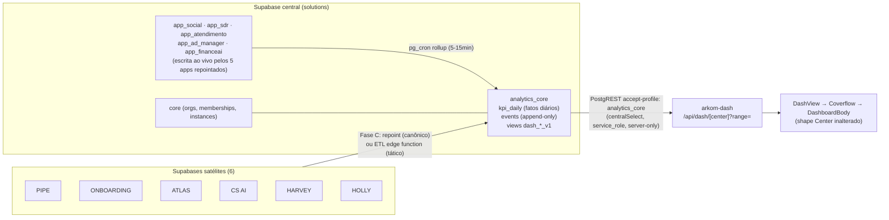

# Arquitetura — Dashboards Unificados (/dash v2)

> **Objetivo:** manter os 6 dashboards da primeira versão do `/dash` (mesma UI, mesmo shape `Center`, mesmo coverflow) e trocar o conteúdo sintético por indicadores reais das 11 soluções Lovable, lidos do banco central Supabase (`solutions` · `auytmefqnuzbktyzcled`).
>
> **Data:** 2026-07-14 · **Base:** arkom-dash `4bb8fe2` (main) · **Insumo:** mapeamento código-a-código das 11 soluções (24 agentes, ver §9)

---

## 1. Princípios

1. **A UI da v1 é o contrato, não o legado.** `DashboardBody` renderiza qualquer `Center { blocks: kpis | signals | row | panel }` — nenhum componente precisa mudar para receber dados reais. O que muda é *quem constrói* o `Center`.
2. **O padrão de reatividade já existe.** `meta-center.ts` prova o modelo: `buildMetaCenter(range, base) → Center` reconstrói os blocks a cada range. Generalizamos esse padrão para os 6 centers, trocando o engine sintético por agregações SQL.
3. **Um único ponto de leitura.** O dash lê o banco central via `src/lib/central.ts` (PostgREST server-only, `accept-profile` por schema). Nada de browser falando com Supabase das soluções.
4. **Demo nunca morre.** O snapshot estático (`dash-data.ts`) vira modo `demo` (vitrine/fallback/skeleton). O modo `live` liga por env. A troca é por center, não tudo-ou-nada.
5. **Centralizar no banco, não no front.** Onde a solução ainda não escreve no central (6 de 11), o dado entra via rollup/ETL no schema `analytics_core` — o front nunca conhece os Supabases satélites.

---

## 2. Estado atual (verificado no código)

### 2.1 O /dash já está montado na versão nova

O commit `f214196` **moveu** (não removeu) a área: `src/app/(aluno)/dash/{page.tsx,dash.css,peek.css}` + `src/components/dash/*` (14 arquivos) estão em `main` e são idênticos à v1 (único ajuste: import do `peek.css` para o novo route group). Consequências:

- `/dash` roda hoje atrás do `requireUser()` do layout `(aluno)` (bypass dev: `ARKOM_DEV_PREVIEW=1`).
- O ⌘K (`palette-data.ts:98-107`) já indexa os 6 centers.
- Pendência de navegação: `MapTopbar.tsx:23` ainda marca a aba DASHBOARDS como `locked: true` (o `ChartTopbar` já aponta destravado) — destravar ao ativar o modo live.
- Os 6 centers continuam 100% sintéticos (`dash-data.ts`, negócio fictício "Brightline", inglês); só o center Meta é reativo a range (engine determinístico, âncora fixa 11-jun-2026).

### 2.2 O banco central é real e já tem 5 soluções dentro

Projeto Supabase `solutions` (`auytmefqnuzbktyzcled`, org própria bilhon-core). Schemas vivos:

| Schema | Conteúdo | Status |
|---|---|---|
| `core` | organizations, memberships, profiles, app_instances, remix_link + RPCs (provision/claim) | vivo |
| `app_social` | SOCIAL Connect (autopilot_posts, creations, analytics_snapshots…) | vivo — app repointado |
| `app_sdr` | BIA SDR (deals, conversations, messages, broadcasts, appointments…) | vivo — app repointado |
| `app_atendimento` | DESK (whatsapp_conversations, messages, sentiment…) | vivo — app repointado |
| `app_ad_manager` | ADS (insights_snapshots, automation_settings, ai_action_proposals…) | vivo — app repointado |
| `app_financeai` | FINANCE (~62 tabelas: transactions, invoices, bills_payable…) | vivo — app repointado |
| `educacional` | bilhon-ai (16 tabelas) + Genesis builder_* — **fora do PostgREST**, só Postgres direto | vivo |
| `app_arkom` | runtime demo do arkom-dash (paridade via migration 0008) | vivo |
| `analytics_core` | **só planejado** — tipo em `central.ts:17` + Fase 5 do UNIFIED-INFRA-BLUEPRINT | a criar |

Ainda em Supabase próprio (Lovable-managed): **PIPE** (`pysbhyejafttrjmmuutx` — marcado *descontinuado* no TRACKING.md), **ONBOARDING** (`gmihrjyvkwyffomxburu`, com drift de ref no vite.config), **ATLAS** (`akqcgxixihrkmdfebgwb`), **CS AI** (`qowqxqkknfjmegujybiy`), **HARVEY** (`bljefpnicdkjarikifdt`), **HOLLY** (`abpgzbaahqwgloacnasc`).

### 2.3 Canais de leitura já existentes no arkom-dash

1. `src/lib/central.ts` — PostgREST com service_role, schema por header (`accept-profile`). Hoje só o `remix.ts` usa (`core`). **É o canal do dash unificado.**
2. `src/lib/central-auth.ts` — auth central GoTrue (o aluno do arkom-dash é o mesmo `auth.users` das 5 soluções repointadas → dá para resolver a org do aluno via `core.memberships`).
3. `src/lib/db.ts` (`ARKOM_DATABASE_URL`) e `EDUCACIONAL_DATABASE_URL` — Postgres direto (runtime próprio e Genesis).

---

## 3. Mapa das soluções → indicadores (inventário)

Resumo do mapeamento código-a-código (11 repositórios, 59 telas de dashboard, ~230 KPIs catalogados). Indicadores âncora escolhidos para o dash unificado:

| Solução | Schema/fonte | Indicadores âncora (fórmula verificada no código) |
|---|---|---|
| **ADS** (bilhon-ad-manager) | `app_ad_manager` + Meta Graph API | Gasto, Leads, CPL, CTR, CPM, Freq; **ROAS real (Shopify) vs pixel**; MER vs `automation_settings.target_roas`; CAC vs `max_cpa`; Saúde da conta 0-100 (`strategicInsights.ts`); pacing mensal; bleeders (ROAS<1) + `ai_action_proposals` pendentes |
| **BIA SDR** (bilhon-sdr-suite) | `app_sdr` | Novos leads (`contacts.created_at`); conversas ativas (`conversations.last_message_at`); conversões (`deals.won_at` + `appointments`); receita ganha (`deals.value` won); pipeline aberto; win rate; tempo de resposta IA (`messages.bia_response_time`); disparos: taxa de entrega (`broadcast_campaigns.sent_count/total_recipients`) |
| **DESK** (bilhon-support-hub) | `app_atendimento` | Conversas atendidas; TME 1ª resposta; TMR; taxa de resolução (`status='closed'`); fila sem atribuição; % sentimento negativo (proxy CSAT, `whatsapp_sentiment_analysis`); produtividade por agente |
| **FINANCE** (bilhon-finance-ai) | `app_financeai` | Receita do mês (`transactions` confirmed); lucro líquido; margem %; saldo projetado 3m + risco (edge `ai-forecast`); compromissos a pagar (`bills_payable`+`tax_guides`); faturamento fiscal autorizado (`invoices`); pipeline de vendas (`sales_orders`); alertas de estoque |
| **SOCIAL** (bilhon-social-connect) | `app_social` | Seguidores totais; engajamento médio %; posts publicados/agendados (`autopilot_posts`); Social Score 0-100 (portável p/ SQL); autopilots ativos/atrasados (`next_run_at`); taxa de falha de publicação |
| **PIPE** (crm-armo) | próprio (descontinuado?) | Pipeline aberto; forecast realista (prob≥50, 90d); win rate; ticket médio; ciclo médio; atingimento de meta (`sales_goals`); negócios em risco (>14d parados) |
| **CS AI** (plataforma-de-cs-remix) | próprio | MRR ativo + Δ30d (RPC `get_dashboard_home_stats`); distribuição de health (green/yellow/red); NPS 30d; MRR em renovação 30d; tickets abertos + SLA em risco; alertas EWS críticos; tarefas atrasadas |
| **ONBOARDING** (gestor-de-onboarding) | próprio | Onboardings ativos; em risco/atrasados; progresso médio por trilha; ramp-up médio (dias); eNPS; taxa de coleta de documentos; aderência a 1:1s |
| **HOLLY** (bia-rh) | próprio | Novos candidatos; entrevistas agendadas 7d; taxa de comparecimento (meta ≥75%); tempo até qualificação; contratações (`deals.won_at`); vagas abertas; tempo de resposta IA |
| **HARVEY** (peticionamento-com-ia-51) | próprio | Documentos gerados (mês/total); custo IA mês (`ai_usage_log.cost_estimated`); tokens consumidos; processos ativos; clientes ativos; publicações não lidas |
| **ATLAS** (criador-de-dashboards) | próprio | Dashboards ativos; fontes sincronizadas 24h; alertas disparados 30d; insights IA pendentes — *meta-indicadores de uso da ferramenta* |

Inventário completo (todas as telas, todos os KPIs, fórmulas, arquivos): ver JSONs de mapeamento em anexo do processo (§9).

---

## 4. Os 6 dashboards unificados

Mesmos 6 centers, mesma ordem no anel, mesmas cores/estrutura de blocks da v1. O que muda: nome/tools/KPIs passam a compor as soluções. Layout de blocks preservado 1:1 com a v1 (kpis → signals → row 2:1 → row 1:2 → panel), o que garante zero mudança de CSS/UX.

### C1 · AQUISIÇÃO PAGA — antes "Meta Ads · Paid Acquisition" (roxo #a78bfa)
**Solução:** ADS (`app_ad_manager`) · **Ranges:** 7d/14d/30d/90d

| Bloco v1 | Versão unificada | Fonte |
|---|---|---|
| 6 KPIs (Spend, Leads, CPL, CTR, CPM, Freq) | mesmos 6 + badge Δ vs janela anterior | `insights_snapshots` (materializado por cron; ver §6.3) |
| Signals (3) | Saúde da conta <70 · pacing over/under (`computePacing`) · bleeders + propostas IA pendentes | `strategicInsights` portado p/ SQL + `ai_action_proposals` |
| Área 2:1 (Spend & CPL) | idêntica, série diária real | `insights_snapshots` por dia |
| Bars (placement/idade) | gasto por campanha · leads por campanha (breakdowns quando snapshotados) | idem |
| Pacing + Creative leaderboard | pacing por campanha (budget vs entrega) · leaderboard de criativos por CPL | idem |
| Tabela Campanhas | idêntica (nome, delivery, budget, spend, leads, CPL, CTR, freq) | idem |

**KPI novo que a v1 não tinha e o ADS entrega:** ROAS real (reconciliação Shopify) vs ROAS pixel — vira o primeiro KPI, é o "Norte da conta" do próprio ADS.

### C2 · PIPELINE COMERCIAL — antes "HubSpot · Sales Pipeline" (vermelho #ef4444)
**Soluções:** BIA SDR (`app_sdr`, funil canônico hoje) + PIPE (quando centralizar) · **Ranges:** All / Stalled / Closing ≤30d

| Bloco v1 | Versão unificada | Fonte |
|---|---|---|
| 5 KPIs (Open Pipeline, Weighted Forecast, Won, Win Rate, Avg Cycle) | mesmos 5: `sum(value) open` · `sum(value×probability)` · `sum(won_at∈per)` · `won/(won+lost)` · `avg(won_at−created_at)` | `app_sdr.deals` + `pipeline_stages` |
| Bars (stage/source) | pipeline por estágio (idêntico) · leads por origem (contacts.source se existir; senão por instância WhatsApp) | `deals`+`pipeline_stages` / `contacts` |
| Signals | R$ parado >14d (stalled) · deals fechando ≤14d · novos leads do SDR no período | `deals.updated_at` · `contacts.created_at` |
| Tabela Open deals | idêntica (deal, estágio+chip Stalled, valor, fecha em, owner, última atividade) | `deals` + `deal_activities` |

**Decisão pendente (§8):** PIPE/crm-armo consta descontinuado no TRACKING.md e o SDR já tem funil próprio no central. Recomendação: `app_sdr.deals` é o funil canônico; se o PIPE voltar, entra como segundo pipeline no mesmo center.

### C3 · FINANCEIRO — antes "Xero · Finance" (amarelo #facc15)
**Solução:** FINANCE (`app_financeai`) · **Ranges:** 6 mo / 12 mo

| Bloco v1 | Versão unificada | Fonte |
|---|---|---|
| 4 KPIs (Cash, Revenue, Net Profit, Receivables) | Receita mês · Lucro líquido mês · Margem % · Compromissos a pagar (bills+impostos, destacando vencidos) | `transactions` (type/status/date) · `bills_payable` · `tax_guides` |
| Área 2:1 (Revenue & profit 12m) | idêntica: mensal confirmed | `transactions` GROUP BY month |
| Bars (aged receivables / cash by account) | aging de contas a pagar (current/1-30/31-60/60+) · fiscal autorizado por tipo (NFe/NFSe) | `bills_payable.vencimento` · `invoices` |
| Signals | Saldo projetado 3m + nível de risco (forecast IA) · maior credor concentrado · alertas de estoque baixo | edge `ai-forecast` persistido · `products` |
| Tabela Invoices | idêntica (doc, cliente, total, vence, status Paid/Awaiting/Draft) | `invoices` + `bills_payable` |

### C4 · CONTEÚDO & SOCIAL — antes "Instagram + TikTok · Content" (rosa #fb7185)
**Solução:** SOCIAL Connect (`app_social`) · **Ranges:** 7d/14d/28d

| Bloco v1 | Versão unificada | Fonte |
|---|---|---|
| 5 KPIs (Views, Reach, Engaged, Net Followers, Interactions) | Seguidores totais · Engajamento médio % · Posts publicados · Posts agendados · Social Score 0-100 | `analytics_snapshots` (**pré-requisito: ligar a escrita — §6.3**) · `autopilot_posts` |
| Área (daily views) | série diária de seguidores/engajamento (snapshots) | `analytics_snapshots` por dia |
| Bars (traffic sources / followers by age) | seguidores por plataforma · engajamento por plataforma | idem |
| Signals | Autopilot atrasado (`next_run_at < now`) · taxa de falha de publicação · % criações aproveitadas (Studio) | `autopilot_configs` · `autopilot_posts.error_message` · `creations` |
| Tabela Top posts | idêntica (post, tipo, views/likes/comments, data) | `autopilot_posts` publicados + payload de métricas |

### C5 · OUTBOUND & ATENDIMENTO IA — antes "Instantly + HeyReach · Outbound" (laranja #ff9d5c)
**Solução:** BIA SDR (`app_sdr` — disparos + conversas) · **Ranges:** 7d/14d/30d/90d

| Bloco v1 | Versão unificada | Fonte |
|---|---|---|
| 5 KPIs (Sent, Replies, Opportunities, Pipeline Value, Bounce) | Disparos enviados · Taxa de entrega · Conversas ativas · Novos leads · Agendamentos criados | `broadcast_campaigns` (sent/failed/total) · `conversations` · `contacts` · `appointments` |
| Área (sends & replies) | mensagens enviadas × recebidas por dia | `messages.sent_at` + direção |
| Sections (deliverability + inboxes + LinkedIn) | saúde por instância WhatsApp (conectada/desconectada, fila `send_queue`) · funil leads→qualificados→agendados | `whatsapp_instances` · `send_queue` · `deals`/`appointments` |
| Signals | Tempo de resposta da IA (`bia_response_time`) fora da meta · campanha com falha alta · fila de envio acumulada | `messages` · `broadcast_campaigns.failed_count` |
| Tabela Campanhas | idêntica (campanha, enviados, taxa de entrega, oportunidades geradas) | `broadcast_campaigns` (+`broadcast_recipients`) |

### C6 · OPERAÇÕES & CLIENTE (MISSION CONTROL) — antes "Mission Control · Client Delivery" (teal #5eead4)
**Soluções:** DESK (`app_atendimento`, live) + CS AI, ONBOARDING, HOLLY, HARVEY (fase C) — o center cross-solução.

| Bloco v1 | Versão unificada | Fonte |
|---|---|---|
| 5 KPIs (Engagements, Shipped, On-Time, Open Items, Avg Response) | Conversas atendidas (DESK) · Taxa de resolução · TMR · MRR da carteira (CS AI) · NPS 30d | `whatsapp_conversations`/`messages` · RPC `get_dashboard_home_stats` (pós-centralização) |
| Signals | Fila sem atribuição · % sentimento negativo · tickets com SLA em risco · alertas EWS críticos · onboardings em risco | DESK sentiment · CS `tickets`/`alerts` · ONBOARDING `employee_onboardings` |
| Tabela Engagements (2:1) | Carteira por health: cliente, health badge, MRR, renovação em Xd, status | CS AI `clients`+`contracts` |
| **Feed "run by agents"** | **feed real cross-solução**: petição gerada (HARVEY) · candidato qualificado (HOLLY) · onboarding concluído · ticket resolvido (DESK) · post publicado (SOCIAL) · proposta de otimização (ADS) | `analytics_core.events` (§5.2) — **é o herói do dashboard unificado** |

Enquanto CS AI/ONBOARDING/HOLLY/HARVEY não estiverem no central, C6 opera em modo parcial (DESK real + demais painéis em demo com selo "aguardando centralização").

---

## 5. Arquitetura de dados

### 5.1 Visão em camadas



### 5.2 Schema `analytics_core` (novo — DDL versionado em `db/central/`)

Materializa a Fase 5 do UNIFIED-INFRA-BLUEPRINT. Três objetos:

```sql
-- 0001-analytics-core.sql (aplicado por operador via ARKOM_MIGRATION_DATABASE_URL)
create schema if not exists analytics_core;

-- (a) Fatos diários por métrica — alimenta KPIs, sparklines e áreas
create table analytics_core.kpi_daily (
  source_app  text        not null,  -- 'ads' | 'sdr' | 'social' | 'financeai' | 'atendimento' | 'cs' | ...
  org_id      uuid,                  -- null = agregado global
  metric      text        not null,  -- 'spend' | 'leads' | 'mrr' | 'followers' | ...
  day         date        not null,
  value       numeric     not null,
  dims        jsonb       not null default '{}'::jsonb,  -- ex.: {"campaign_id": "...", "platform": "instagram"}
  computed_at timestamptz not null default now(),
  primary key (source_app, coalesce(org_id,'00000000-0000-0000-0000-000000000000'::uuid), metric, day, dims)
);

-- (b) Eventos append-only — alimenta o feed do Mission Control (C6)
create table analytics_core.events (
  id          bigint generated always as identity primary key,
  source_app  text        not null,
  org_id      uuid,
  entity_type text        not null,  -- 'deal' | 'post' | 'ticket' | 'document' | ...
  event_type  text        not null,  -- 'won' | 'published' | 'resolved' | 'generated' | ...
  occurred_at timestamptz not null,
  actor       text,                  -- 'ia' | 'humano' | nome do agente
  metadata    jsonb       not null default '{}'::jsonb
);
create index on analytics_core.events (occurred_at desc);
create index on analytics_core.events (source_app, occurred_at desc);

-- (c) Views por center — o contrato de leitura do dash (1 view = 1 center, versionada)
--     ex.: analytics_core.dash_pipeline_v1: agrega app_sdr.deals por estágio/dia
--     ex.: analytics_core.dash_financeiro_v1: transactions por mês/tipo
```

**Como popular (por origem):**

| Origem | Mecanismo | Latência |
|---|---|---|
| 5 schemas `app_*` (mesmo banco) | **pg_cron** rodando funções SQL `analytics_core.rollup_<app>()` — sem ETL externo, sem rede | 5–15 min |
| ADS / métricas Meta | tabela `app_ad_manager.insights_snapshots` já existe; criar cron (edge function agendada) que puxa a Graph API server-side e insere — hoje o front chama a Meta do browser e nada persiste (§6.3) | horária |
| SOCIAL / Apify | ligar a escrita de `app_social.analytics_snapshots` na edge `social_social-analytics` (hoje só localStorage — §6.3) | por refresh/diária |
| 6 soluções satélites (fase tática) | edge function no central com service key de cada satélite, lendo agregados via PostgREST e gravando `kpi_daily`/`events` com `source_app` | 15–60 min |
| 6 soluções satélites (fase canônica) | **repoint** (mesmo processo das 5 primeiras: schema `app_*`, client `db.schema`, claim via `core`) → passam para a linha 1 | ao vivo |

**Regra de ouro:** o arkom-dash lê **somente** `analytics_core` (+ `core` para org). Nunca lê `app_*` diretamente em produção — assim o repoint das satélites não muda nada no dash, só troca o alimentador. (Exceção pragmática na Fase 1, ver roadmap: leitura direta de `app_*` atrás da mesma interface `sources/`, até os rollups existirem.)

### 5.3 Multi-tenancy: dois modos de visão

Os schemas `app_*` são multi-tenant (`org_id` + `core.organizations`), e o auth do arkom-dash já é o auth central:

- **Visão do aluno (default):** resolve `org_id` do usuário logado via `core.memberships` (auth central compartilhado) e filtra tudo por ele. O aluno vê *os dashboards da empresa dele* — mesmos 6 centers, dados da org.
- **Visão global (admin):** `org_id = null` nos rollups = agregado de toda a operação. Gate por `arkom_role=admin` (claim já existente em `central-auth.ts`).

O builder recebe `(range, orgId | null)` — o mesmo `Center` serve às duas visões.

### 5.4 Segurança

- Toda leitura via `centralSelect` (service_role) **exclusivamente** em route handlers/server actions autenticados (`requireUser()` + resolução de org). O comentário do próprio `middleware.ts` avisa que layout não é fronteira de segurança em RSC — com dados reais, a fronteira passa a ser o handler: sem sessão → 401, org sempre derivada da sessão (nunca de query param).
- `analytics_core` não recebe policies permissivas: service_role only (o PostgREST não expõe o schema a anon/authenticated).
- DDL do central passa a ser **versionado** em `db/central/` no arkom-dash (hoje o DDL de `core`/`app_*` foi aplicado out-of-band e não tem fonte de verdade — gap real do processo).

---

## 6. Arquitetura da aplicação (arkom-dash)

### 6.1 Estrutura de arquivos proposta

```
src/lib/dash/
  types.ts            # re-exporta Center/Block/Panel/Cell de components/dash/dash-data
  registry.ts         # os 6 centers live: chrome (id/nome/cor/tools/ranges/guide) + builder
  mode.ts             # DASH_DATA_MODE: 'demo' | 'live' (por center: DASH_LIVE_CENTERS=c1,c3)
  central-read.ts     # helpers server-only sobre centralSelect: kpiDaily(), series(), eventsFeed()
  sources/            # 1 módulo por center — SQL/PostgREST → agregados tipados
    aquisicao.ts      #   app_ad_manager (via analytics_core)
    comercial.ts      #   app_sdr (deals)
    financeiro.ts     #   app_financeai
    social.ts         #   app_social
    outbound.ts       #   app_sdr (broadcasts/conversas)
    operacoes.ts      #   app_atendimento + cs/onboarding/rh/juridico + events
  builders/           # agregados → Block[] (mesma pegada do buildMetaCenter)
    build-aquisicao.ts … build-operacoes.ts
src/app/api/dash/[center]/route.ts   # GET ?range= → Center JSON (auth + org + cache)
db/central/
  0001-analytics-core.sql
  0002-dash-views.sql
  0003-cron-rollups.sql
```

### 6.2 Fluxo de renderização (generalização do padrão meta-center)

1. `Dashboard.tsx` hoje: `center.id === "meta" ? buildMetaCenter(range, center) : center`. Passa a: se o center está em modo live, busca `GET /api/dash/${id}?range=` (SWR, keepPreviousData) e usa o snapshot demo como estado inicial/skeleton; senão, comporta-se como hoje.
2. O route handler roda server-side: `requireUser()` → org → `sources/<center>.getAggregates(range, orgId)` → `builders/build<center>(aggregates, base)` → `Center` JSON. `Center` é JSON puro — atravessa a fronteira sem adaptação, e `DashboardBody`, `PeekPanel`, `charts.tsx` não mudam **uma linha**.
3. Builders preservam a gramática visual da v1: mesmos formatadores (`usd0/num0/usd2/pct2` + variantes BRL `brl0/brl2`), mesmos chips (`active/learning/fatigue/paused/quality`), badges Δ% = janela atual vs janela anterior (o `rollup(range*2).slice(0, range)` do meta-engine vira `kpi_daily` de 2×range dias).
4. Âncora temporal deriva de `max(day)` do `kpi_daily` (nunca hardcoded — corrige o envelhecimento da âncora 11-jun-2026 do engine).
5. Peek drill (fase 4): endpoints `/api/dash/[center]/peek?entity=` devolvendo os shapes `Sec`/`TCell` de `peek-data.ts`.
6. Cache: `kpi_daily` já é pré-agregado; o handler ainda assim usa `unstable_cache`/revalidate 60s por (center, range, org) para segurar rajadas.

### 6.3 Correções pré-requisito nas soluções (descobertas no mapeamento)

| Solução | Correção | Por quê |
|---|---|---|
| SOCIAL | Ligar escrita de `analytics_snapshots` na edge `social_social-analytics` | Hoje seguidores/engajamento vivem **só em localStorage** — sem isso C4 não tem série histórica |
| ADS | Cron server-side Meta Graph API → `insights_snapshots` | Hoje o front chama a Meta do browser com token do usuário; central nunca vê os números |
| DESK | Corrigir bug da fila (`{count:'exact'}` lido de `data` em vez de `count` → sempre 0) e portar agregações client-side para views SQL | KPI errado hoje; e o relatório baixa todas as mensagens pro browser |
| PIPE/SDR | Padronizar atribuição temporal de receita por `won_at` (PIPE usa `created_at`) | Sem isso "receita do mês" diverge entre soluções |
| HOLLY | Separar "Conversões" (deals ganhos) de appointments criados | O card atual soma os dois e infla |
| HARVEY | Não consumir o fallback MOCK_STATS (47 petições…) — no unificado, org sem dados = zero real | Mock silencioso contaminaria o executivo |
| ONBOARDING | Ignorar DemoModeContext/mocks; consumir só a edge `onboardia-data` / tabelas | Demo liga sozinho no 1º acesso |
| ATLAS | Decidir escopo (§8): meta-indicadores de uso vs. fora do dash | É um builder de dashboards, não uma fonte de negócio |

---

## 7. Roadmap

**Fase 0 — Fundação no arkom-dash (não depende de banco)**
Criar `lib/dash/{types,registry,mode}`, route handler `/api/dash/[center]` devolvendo o snapshot demo, `Dashboard.tsx` consumindo por SWR com fallback. Traduzir chrome dos 6 centers (nomes/subs PT via `DASH_PT`). Destravar aba DASHBOARDS no `MapTopbar`.
*Aceite:* /dash idêntico ao atual, mas 100% servido pela API; modo demo/live chaveável por env.

**Fase 1 — 5 soluções centralizadas, leitura direta**
Views `dash_*_v1` sobre `app_sdr`/`app_financeai`/`app_social`/`app_atendimento`/`app_ad_manager` (+ correções §6.3 de SOCIAL e ADS). Builders C1-C5 + C6 parcial (DESK). Visão do aluno por org.
*Aceite:* os 6 centers com dados reais nos ranges; badges Δ% corretos; demo permanece como fallback de erro.

**Fase 2 — analytics_core (kpi_daily + events + pg_cron)**
DDL versionado, rollups dos 5 `app_*`, feed de eventos no C6, sparklines históricos, visão global admin. Dash passa a ler só `analytics_core`.
*Aceite:* `kpi_daily` populado ≥30 dias (backfill via SQL histórico); feed exibindo eventos reais de ≥3 soluções.

**Fase 3 — As 6 satélites entram**
Tático primeiro (ETL edge → `kpi_daily`/`events` de CS AI, ONBOARDING, HOLLY, HARVEY), canônico depois (repoint → `app_cs`, `app_onboarding`, `app_rh`, `app_juridico`), na ordem de valor executivo: **CS AI (MRR/NPS) → ONBOARDING → HOLLY → HARVEY**. Decisões de PIPE e ATLAS (§8) executadas.
*Aceite:* C2 e C6 completos; nenhuma leitura fora do central.

**Fase 4 — Profundidade**
Peek drill real (campanha→adset→ad no C1; cliente→contratos→tickets no C6), GuideModal por solução (link "abrir no app" via `core.app_instances.deploy_url`), metas (sales_goals, target_roas) como linhas de referência, alertas cross-solução no topbar.

---

## 8. Decisões em aberto (donos do produto)

1. **PIPE (crm-armo):** TRACKING.md marca como descontinuado, e `app_sdr.deals` já cobre funil. Manter PIPE fora e SDR como funil canônico do C2? (Recomendação: sim.)
2. **ATLAS:** entra como meta-indicadores de uso no C6, ou fica fora do dash unificado (é ferramenta, não operação)? (Recomendação: fora na v1; reavaliar depois.)
3. **Visão default do aluno:** org própria (recomendado) ou demo até a org ter dados?
4. **CMO (agente-aut-nomo-cmo):** está no registry de remix (`core.remix_link`) mas a cópia do repo aponta para Supabase próprio — confirmar se foi repointado antes de prometê-lo em qualquer center.
5. **Idioma dos dados:** chrome já é PT via `DASH_PT`; labels de KPI novos nascem PT direto nos builders (dados das soluções já são PT). Confirmar que o modo EN pode exibir PT nos dados (Layer-C já prevê isso).

## 9. Proveniência deste documento

Mapeamento executado em 2026-07-14 por 24 agentes (workflow `arkom-unified-dash-mapping`): 11 mapeadores + 11 verificadores de completude (1 por repositório clonado de Bilhon-OS) + 1 investigação do banco central + 1 análise do contrato de renderização da v1. Fórmulas e fontes citadas foram verificadas contra o código dos repositórios em seus estados de 2026-07-10 a 2026-07-14. JSONs completos do mapeamento (por solução, com arquivo:linha de cada KPI, mais `central.json` e `remount.json`) preservados em `C:\Users\Darkr\ClaudeCode\Arkom\solutions\mapping\`.
