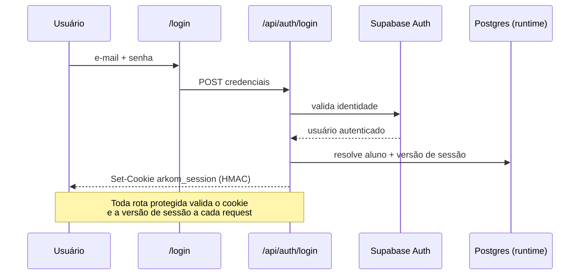
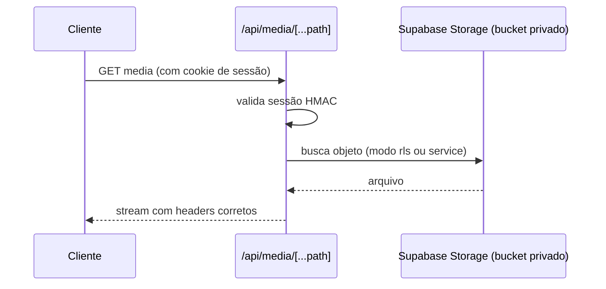
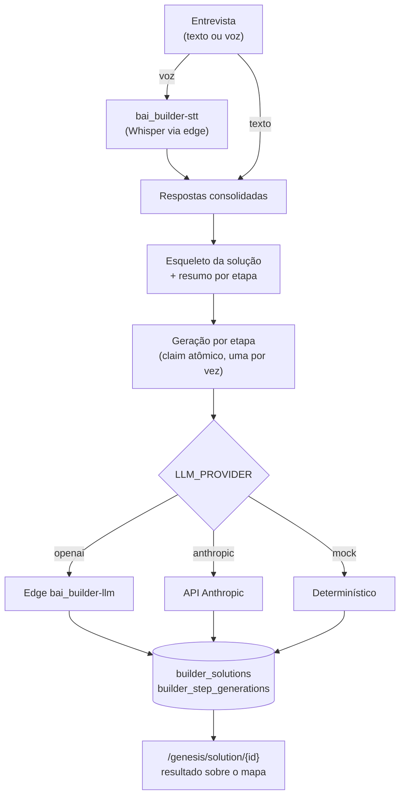

## Autenticação e sessão

## Mídia privada

<Warning>
  Nenhuma mídia é pública. `cover_url` e `resource.url` apontam para o proxy `/api/media/` — o acesso direto ao bucket é bloqueado por policies.
</Warning>

## Geração de solução (Genesis)

Pontos-chave do pipeline (detalhes em [Genesis Builder](/logic/genesis-builder)):

- **Claim atômico por etapa** — evita geração duplicada em duplo clique, refresh ou navegação no meio da cascata; requests concorrentes fazem *join* aguardando a etapa sair de `generating`
- **Structured output** — cada etapa força uma tool com `input_schema` igual ao contrato da etapa
- **Mock nunca vira dado real** — falha marca a etapa como `error` e o usuário regenera

## Tema e idioma

| Preferência | Persistência | Aplicação |
|-------------|--------------|-----------|
| Tema claro/escuro | Banco por usuário (migration 0005) + `localStorage` | `html[data-theme]` com script anti-flash no `<head>` |
| Idioma EN⇄PT | `localStorage` | Dicionário type-safe, default PT |
