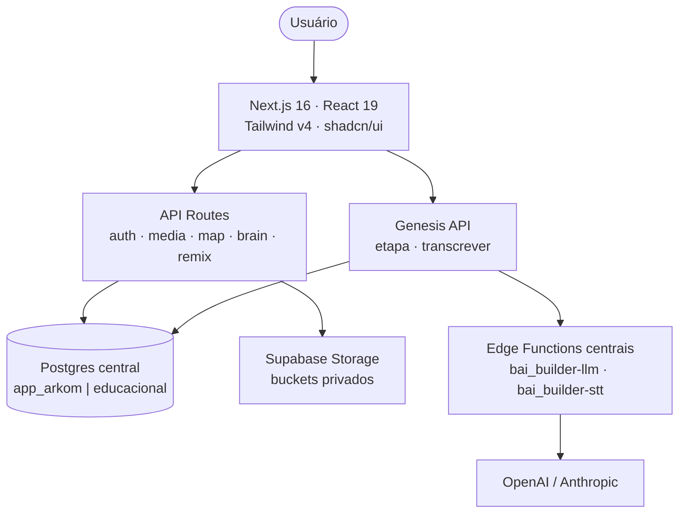

## Stack tecnológica

## Camadas da aplicação

### 1. Apresentação

App Router com três route groups: `(aluno)` (15 rotas), `(auth)` (4 rotas) e `(conta)`, mais a árvore `/admin` (10 rotas). Todos compartilham o mesmo design system (steel dark, ouro/ivory, glass). Ver [Mapa de Rotas](/architecture/rotas).

### 2. Lógica de negócio

Concentrada em `src/lib/`: autenticação e sessão (`auth.ts`, `central-auth.ts`), builder do Genesis (`builder.ts`, `builder-schema.ts`), i18n type-safe (`i18n/`), tema (`theme.tsx`), storage de mídia (`media-storage.ts`) e a marca em um único lugar (`brand.ts`).

### 3. Persistência

Postgres no Supabase central via driver `postgres`, com `search_path` definido por `ARKOM_RUNTIME_SCHEMA`. Mídia em bucket **privado**, servida exclusivamente por `/api/media/[...path]` gated por sessão. Ver [Banco de Dados](/database/overview).

## Os dois modos de runtime

O mesmo código roda sobre dois conjuntos de dados — **config, não código**:

| Modo | Schema | Bucket | O que é |
|------|--------|--------|---------|
| `app_arkom` (default) | dedicado | `arkom-media` | Ambiente demo isolado; role LOGIN sem `BYPASSRLS` |
| `educacional` | central | `bilhon-media` | Corte para os dados reais do bilhon-ai; flip reversível por envs |

## Decisões arquiteturais

<AccordionGroup>
  <Accordion title="Por que sessão HMAC própria em vez de sessão do Supabase Auth?">
    O cookie `arkom_session` assinado com `ARKOM_SESSION_SECRET` dá controle total do ciclo de vida (login, logout, invalidação global via versionamento de sessão — migration 0006) e desacopla o runtime do Supabase Auth, que segue como fonte de identidade via link Auth↔Central (migration 0002).
  </Accordion>
  <Accordion title="Por que dois schemas em vez de dois bancos?">
    O flip demo → dados reais vira uma troca de envs (`ARKOM_RUNTIME_SCHEMA` + URL + bucket), reversível em minutos, sem migração de dados. As credenciais de runtime são limitadas por role: `app_arkom` nunca enxerga `educacional` e vice-versa.
  </Accordion>
  <Accordion title="Por que as chaves de LLM não ficam no app?">
    No modo padrão a `OPENAI_API_KEY` vive nos secrets das Edge Functions do Supabase central. O app só proxeia com a service role — zero chave de IA no deploy, rotação centralizada.
  </Accordion>
  <Accordion title="Por que i18n próprio em vez de uma lib?">
    O dicionário EN/PT é type-safe por construção (chaves verificadas pelo compilador), o default é português e o toggle persiste em localStorage. Uma lib completa adicionaria peso sem benefício para dois idiomas.
  </Accordion>
</AccordionGroup>
