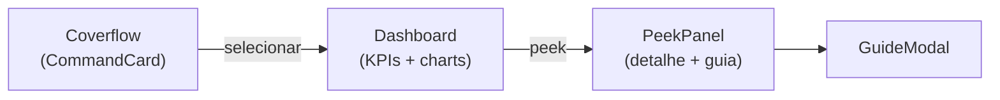

## Responsabilidade

O `/dash` apresenta as **centrais de comando**: painéis operacionais (ex.: Meta Ads) exibidos em coverflow, cada um com KPIs e um *peek* detalhado com gráficos.

## Componentes

| Componente | Responsabilidade |
|-----------|------------------|
| `DashView.tsx` | Orquestra a página |
| `Coverflow.tsx` | O carrossel 3D de painéis |
| `CommandCard.tsx` | Card de uma central de comando |
| `Dashboard.tsx` · `DashboardBody.tsx` | Estrutura do painel aberto |
| `PeekPanel.tsx` | Peek lateral com o detalhe da central |
| `charts.tsx` | Gráficos dos KPIs |
| `GuideModal.tsx` | Modal de guia da central |
| `DashTopbar.tsx` | Abas MAP / DASHBOARDS / CHART |
| `icons.tsx` | Ícones específicos do domínio |

## Dados

| Arquivo | Papel |
|---------|-------|
| `dash-data.ts` | Definição das centrais e seus KPIs |
| `peek-data.ts` | Conteúdo dos peeks |
| `meta-center.ts` · `meta-engine.ts` | Central Meta Ads e sua engine de métricas |

## Fluxo de interação

