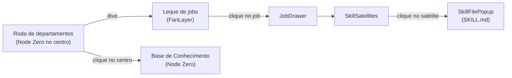

## Responsabilidade

O `/map` é a visão principal do catálogo: uma roda de 7 departamentos orbitando o **Node Zero** (Base de Conhecimento), com câmera de verdade e um vocabulário visual coeso de "espaço" — starfield, haze radial, glass, tipografia Marcellus e SVG que se desenha.

## Componentes

| Componente | Responsabilidade |
|-----------|------------------|
| `MapView.tsx` | Orquestra a cena: câmera, camadas, estado de navegação |
| `RadialGraph.tsx` | O grafo radial de departamentos e jobs |
| `StarField.tsx` | Fundo de estrelas |
| `FanLayer.tsx` | O leque de jobs ao mergulhar num departamento |
| `JobDrawer.tsx` | Drawer de detalhe do job |
| `SkillSatellites.tsx` | Satélites (arquivos de skill) orbitando o job |
| `SkillFilePopup.tsx` · `SkillModal.tsx` | Popup do `SKILL.md` e modal da skill |
| `RPanelReader.tsx` | Painel de leitura lateral |
| `MapTopbar.tsx` | Abas MAP / DASHBOARDS / CHART |
| `BottomDeptNav.tsx` | Navegação inferior por departamento |
| `ZoomControls.tsx` | Controles de zoom |
| `FoundingStrip.tsx` | Faixa institucional |

## Comportamento

- **Câmera** — pan/zoom/dive/slide animados por `requestAnimationFrame` com lerp; o mergulho num departamento é um movimento de câmera, não uma troca de página
- **Tecido conectivo** — linhas SVG que se desenham, nós que aparecem com *pop*, stagger controlado pela variável CSS `--d`
- **Coreografia de hover** — seletor `:has()` escurece o resto do mapa quando um nó recebe foco
- **Escopo de estilo** — tudo escopado em `.mapview` (`map.css`), paleta cobre/ivory

## Fluxo de interação

<Note>
  A linguagem visual do `/map` é a referência da plataforma — o ledger `docs/LEDGER-GENESIS-VS-MAP.md` documenta o plano de levar esse dialeto (câmera, glass, grafo que se constrói) para o Genesis.
</Note>
