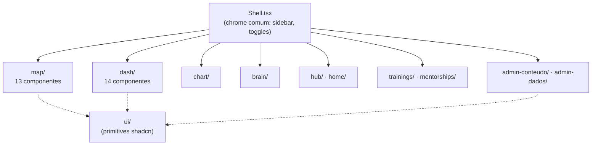

## Estrutura

## Domínios

| Pasta | Responsabilidade |
|-------|------------------|
| `components/map/` | O mapa radial — grafo, starfield, câmera, drawers e satélites |
| `components/dash/` | Centrais de comando — coverflow, cards, peek e gráficos |
| `components/chart/` | Matriz de rollout de autonomia |
| `components/brain/` | Entrevista do segundo cérebro |
| `components/hub/` · `components/home/` | Página inicial e hub |
| `components/trainings/` | Cursos, player de aula e progresso |
| `components/mentorships/` | Mentorias |
| `components/apps/` · `components/modules/` · `components/tree/` | Apps, módulos e árvore de skills |
| `components/admin-conteudo/` · `components/admin-dados/` | Painéis de gestão de conteúdo e dados |
| `components/auth/` · `components/settings/` | Fluxos de conta |
| `components/palette/` | Paleta de comandos |
| `components/ui/` | Primitives shadcn/ui (Button, Dialog, etc.) |

## Componentes raiz

| Componente | Responsabilidade |
|-----------|------------------|
| `Shell.tsx` | Chrome comum a todas as páginas — sidebar, navegação, toggles de idioma/tema |
| `ArkomLogo.tsx` | Wordmark oficial com o spiral-O; cores via `--arkom-ink`/`--arkom-gold` |
| `GlassModal.tsx` | Modal base em glass (backdrop-blur) |
| `LoginModal.tsx` · `PaywallModal.tsx` | Fluxos de login e paywall |

<Note>
  A marca é **uma forma única**: o wordmark ARKOM com o spiral-O como "O". Nunca usar o símbolo ao lado do wordmark (regra de marca 2026-07-06, documentada em `ArkomLogo.tsx`).
</Note>

## Navegação

<CardGroup cols={2}>
  <Card title="Mapa radial" icon="circle-nodes" href="/components/map">
    Os 13 componentes do /map em detalhe
  </Card>
  <Card title="Centrais de comando" icon="gauge-high" href="/components/dash">
    Coverflow, KPIs e peek panels do /dash
  </Card>
</CardGroup>
