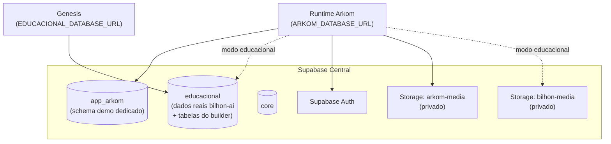

## Topologia

Tudo vive no **Supabase central** (projeto `auytmefqnuzbktyzcled`), separado por schemas:

## Migrations

Ficam em `db/migrations/`, **aplicadas manualmente** por operador autorizado — não existe runner automático.

| Migration | O que faz |
|-----------|-----------|
| `0001-app-arkom-schema.sql` | Cria o schema `app_arkom`, a role-grupo `arkom_runtime` e o bucket `arkom-media` |
| `0002-auth-central-link.sql` | Link entre Supabase Auth e os registros do runtime |
| `0003-authenticated-media-storage.sql` | Policies de storage para mídia autenticada |
| `0005-user-theme-preference.sql` | Preferência de tema por usuário |
| `0006-session-version.sql` | Versionamento de sessão (invalidação global) |
| `0007-auth-identity-integrity.sql` | Constraints de integridade de identidade |
| `0008-central-parity.sql` | Paridade com o schema central (pré-requisito do modo `educacional`) |

<Warning>
  **Antes de qualquer migration no banco central**: capturar o snapshot com `count(*)` por tabela do schema `educacional` (runbook em `db/migrations/README.md`) — é a prova de que os dados reais permaneceram intactos. Migrations rodam **somente** com `ARKOM_MIGRATION_DATABASE_URL`, nunca com a credencial de runtime.
</Warning>

## Separação de credenciais

| Credencial | Escopo | Onde vive |
|------------|--------|-----------|
| `ARKOM_DATABASE_URL` | Runtime — DML mínimo em `app_arkom`, sem `BYPASSRLS`, `search_path` fixo | Deploy da aplicação |
| `ARKOM_MIGRATION_DATABASE_URL` | Privilegiada — criar schemas/roles/policies | Somente estação do operador |
| `EDUCACIONAL_DATABASE_URL` | Builder do Genesis — leitura/escrita no schema `educacional` | Deploy da aplicação |

## Tabelas do builder (Genesis)

| Tabela | Conteúdo |
|--------|----------|
| `builder_solutions` | A solução: ideia original, título, descrição, tags, resumos por etapa |
| `builder_step_generations` | Uma row por etapa gerada — status (`generating`/`done`/`error`), conteúdo JSON |
| `builder_prompt_configs` | Prompts configuráveis por `step_key` (ver [Prompts](/prompts/overview)) |

## Storage

| Bucket | Modo de auth | Uso |
|--------|-------------|-----|
| `arkom-media` | `rls` (JWT + policies) — `service` só em dev/test | Modo `app_arkom` |
| `bilhon-media` | `service` (permitido em produção; acesso gated por sessão em `/api/media`) | Modo `educacional` |

Valores de bucket fora dessa allowlist são **rejeitados pelo servidor**.

## Seed

`ARKOM_AUTO_SEED=true` popula dados de demonstração (`src/db/seed.ts`) — **apenas** em `development`/`test`; em qualquer outro ambiente o processo falha fechado.
