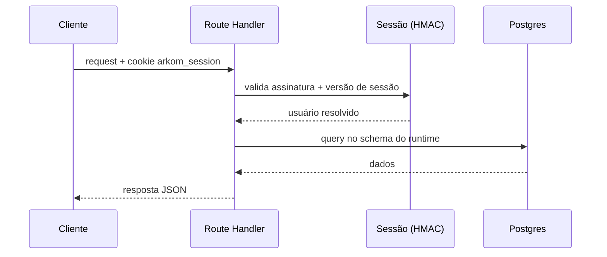

## Autenticação

| Método e rota | Função |
|---------------|--------|
| `POST /api/auth/login` | Valida credenciais no Supabase Auth e emite o cookie `arkom_session` (HMAC) |
| `POST /api/auth/logout` | Encerra a sessão |
| `GET /api/auth/session` | Estado da sessão atual |

## Mídia

| Método e rota | Função |
|---------------|--------|
| `GET /api/media/[...path]` | Serve arquivos do bucket **privado**, gated por sessão — única porta de saída de mídia |

<Warning>
  Não existe URL pública de mídia. Todo `cover_url`/`resource.url` passa por este proxy, que valida a sessão antes de tocar o Storage.
</Warning>

## Genesis

| Método e rota | Função |
|---------------|--------|
| `POST /genesis/api/etapa` | Gera (ou faz *join* na geração de) uma etapa da solução — claim atômico |
| `POST /genesis/api/transcrever` | Transcreve áudio da entrevista via edge `bai_builder-stt` (Whisper) |

## Conteúdo e utilidades

| Método e rota | Função |
|---------------|--------|
| `POST /api/brain-draft` | Rascunhos da entrevista do segundo cérebro |
| `GET /api/map/previews` | Previews dos arquivos de skill exibidos no mapa |
| `GET /api/remix/go/[solution]` | Redirecionamento de remix de soluções |

## Admin

| Método e rota | Função |
|---------------|--------|
| `GET /api/admin/export` | Exportação de dados administrativos |

## Fluxo típico de uma request autenticada

