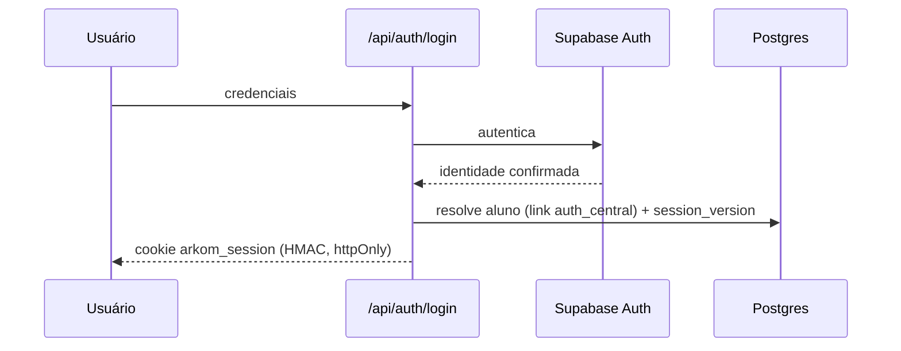

## Responsabilidade

A autenticação combina o **Supabase Auth** (identidade) com uma **sessão própria** (autorização de runtime): após o login, o app emite o cookie `arkom_session` assinado com HMAC (`ARKOM_SESSION_SECRET`).

## Módulos

| Arquivo | Papel |
|---------|-------|
| `src/lib/auth.ts` | Emissão e validação da sessão HMAC |
| `src/lib/central-auth.ts` | Integração com o Supabase Auth central |
| `src/lib/central.ts` | Cliente do projeto central |
| `/api/auth/login` · `logout` · `session` | Ciclo de vida da sessão |

## Fluxo

## Garantias de integridade

| Mecanismo | Migration | O que garante |
|-----------|-----------|---------------|
| Link Auth↔Central | `0002-auth-central-link.sql` | Cada usuário do Auth mapeia para um registro do runtime |
| Versão de sessão | `0006-session-version.sql` | Bump da versão invalida **todas** as sessões emitidas do usuário |
| Integridade de identidade | `0007-auth-identity-integrity.sql` | Constraints impedem identidades órfãs ou duplicadas |

<Warning>
  `ARKOM_SESSION_SECRET` é obrigatório e deve ser um valor aleatório forte (ex.: 48 bytes), gerado fora do repositório e guardado apenas no gerenciador de secrets.
</Warning>

## Fluxos de conta

- **Cadastro por convite** (`/cadastro`) — convites emitidos no admin (`/admin/invites`)
- **Definir senha** (`/definir-senha`) — primeiro acesso
- **Recuperar senha** (`/recuperar-senha`)
- **Login simulado** — sem as envs do Supabase, o fluxo de login roda em modo demo
