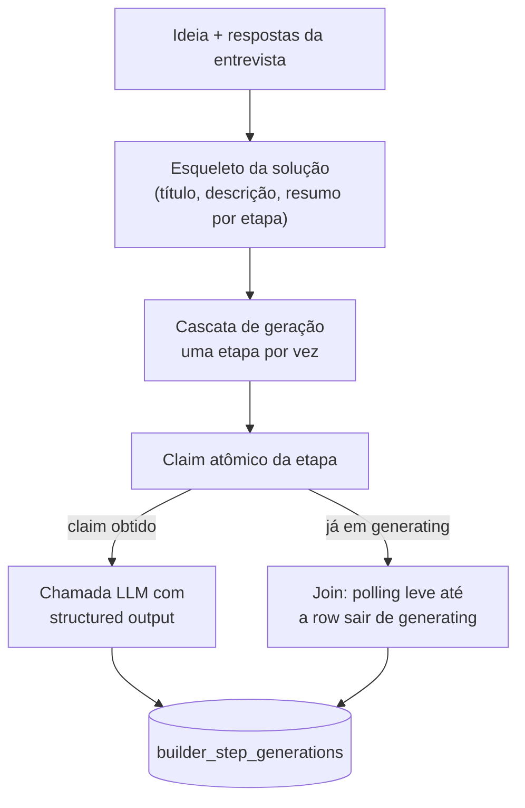

## Responsabilidade

O builder (`src/lib/builder.ts`, ~530 linhas) transforma a ideia do aluno — coletada por entrevista em texto ou voz — em uma **solução estruturada em 8 etapas**, geradas uma a uma por LLM com contrato de saída rígido.

## As 8 etapas (`STEP_ORDER`)

| # | `step_key` | Label | Conteúdo |
|---|-----------|-------|----------|
| 1 | `knowledge_base` | Base de Conhecimento | 5 perguntas · 3 bônus |
| 2 | `framework` | Framework | 5 pilares de implementação |
| 3 | `architecture` | Arquitetura e Fluxos | Mapa mental para o MVP |
| 4 | `tools` | Ferramentas | 6 essenciais · alternativas |
| 5 | `action_plan` | Plano de Ação | PM Agent · 3 sprints |
| 6 | `prompt_lovable` | Prompt Lovable | MVP + follow-ups (cole no Lovable) |
| 7 | `content` | Conteúdos | 8 aulas por sprint |
| 8 | `savings` | Economia | ROI e profissionais |

## Pipeline

## Comportamentos críticos

<Warning>
  **Claim atômico por etapa.** Dois cliques, navegar-e-voltar ou refresh no meio da cascata fazem o cliente re-POSTar as etapas não concluídas. O claim só é obtido se a etapa não está em `generating` fresco; senão o request faz *join* e aguarda a row final por polling.
</Warning>

<Warning>
  **Mock nunca persiste como dado real.** Se a geração falha, a etapa fica com status `error` e o usuário regenera. Conteúdo determinístico do modo `mock` existe apenas para testar o fluxo.
</Warning>

- **Structured output** — com `schema`, a chamada força uma tool com `input_schema` igual ao contrato da etapa; o modelo é obrigado a devolver JSON válido
- **Contexto leve entre etapas** — `depContext` injeta apenas os **resumos curtos** das etapas anteriores (do esqueleto), mantendo coerência sem inflar o input
- **System prompt em camadas** — base (persona de arquiteto + catálogo de preços + regras anti-genérico) + extensões específicas da etapa, ambas configuráveis via `builder_prompt_configs` (ver [Prompts](/prompts/overview))

## Provedores de LLM

| `LLM_PROVIDER` | Caminho | Chave necessária |
|----------------|---------|------------------|
| `openai` (recomendado) | Edge Function central `bai_builder-llm` | Nenhuma no app |
| `anthropic` | API Anthropic direta | `ANTHROPIC_API_KEY` |
| `mock` | Conteúdo determinístico | Nenhuma |
| *(vazio — auto)* | anthropic com key → openai com central → mock | — |

## Transcrição de voz

A entrevista aceita áudio: `/genesis/api/transcrever` envia para a edge `bai_builder-stt` (Whisper, modelo `whisper-1`). A chave OpenAI vive nos secrets da edge — não no app.
