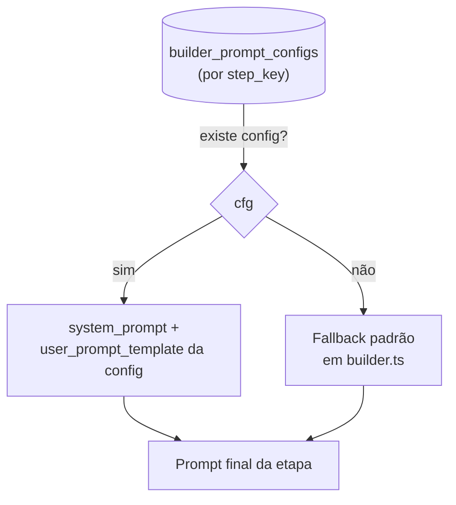

## Arquitetura de prompts

Os prompts do Genesis **não são arquivos no repositório** — vivem na tabela `builder_prompt_configs` (schema `educacional` do Supabase central), com **fallbacks padrão embutidos** em `src/lib/builder.ts`. Isso permite iterar prompts em produção sem deploy.

## Estrutura de uma config

| Coluna | Papel |
|--------|-------|
| `step_key` | Qual das 8 etapas esta config governa |
| `system_prompt` | Extensão de persona/instruções da etapa |
| `user_prompt_template` | Template do prompt de usuário (variáveis `{{idea}}`, `{{answersContext}}`) |
| `price_catalog` | Catálogo de preços injetado (etapas de ferramentas/economia) |
| `anti_generic_rules` | Regras anti-resposta-genérica |

## Composição em camadas

O system prompt final de cada etapa é composto assim:

1. **Base** — persona: *"arquiteto de soluções que desenha soluções construíveis com Lovable + Supabase"* + catálogo + regras anti-genérico
2. **Extensão da etapa** — `system_prompt` específico do `step_key`
3. **Contexto de dependências** — resumos curtos das etapas anteriores (do esqueleto)

<Warning>
  Nunca copie para esta documentação conteúdo de prompts de produção que inclua credenciais, URLs internas ou dados de alunos. Os templates usam placeholders (`{{idea}}`, `{{answersContext}}`).
</Warning>

## Navegação

<CardGroup cols={2}>
  <Card title="Prompts por etapa" icon="list-ol" href="/prompts/genesis-etapas">
    O contrato e o objetivo de cada uma das 8 etapas
  </Card>
  <Card title="Genesis Builder" icon="wand-magic-sparkles" href="/logic/genesis-builder">
    O pipeline que consome esses prompts
  </Card>
</CardGroup>
