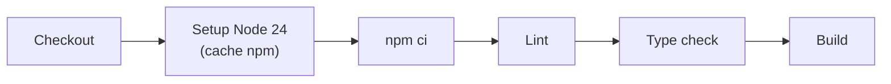

## Suítes E2E (Playwright)

Ficam em `e2e/` e cobrem as jornadas críticas do Genesis e das soluções:

| Suíte | O que cobre |
|-------|-------------|
| `genesis.spec.ts` | Fluxo do builder de soluções |
| `genesis-video.spec.ts` | Genesis com mídia/vídeo |
| `solution-journey.spec.ts` | Jornada completa da solução gerada |
| `solution-mentoria.spec.ts` | Solução do tipo mentoria |
| `solution-sdr.spec.ts` | Solução do tipo SDR |

```bash
npx playwright test            # todas as suítes
npx playwright test genesis    # uma suíte específica
```

<Note>
  Use `LLM_PROVIDER=mock` para exercitar o fluxo completo do Genesis nos testes sem chave de IA e com conteúdo determinístico.
</Note>

## Checks locais

```bash
npm run check   # lint + typecheck + build
```

## CI — GitHub Actions

Pipeline em `.github/workflows/ci.yml` (job `quality`, Node 24, timeout 15 min):



<Warning>
  O workflow dispara em push/PR para a branch `master` — as branches ativas do repositório são `main` e `producao`. Para o CI rodar nelas, ajuste os gatilhos em `.github/workflows/ci.yml`.
</Warning>

## Scripts operacionais

| Script | Função |
|--------|--------|
| `scripts/sync-capacitacoes.mjs` | Sincroniza capacitações |
| `scripts/verify-builder-schema.mjs` | Valida os contratos das etapas do builder |
| `scripts/verify-playbook-coverage.mjs` | Verifica cobertura do playbook |
| `scripts/probe-solutions.mjs` | Sonda soluções geradas |
| `scripts/clear-vdi-previews.mjs` | Limpa previews |
