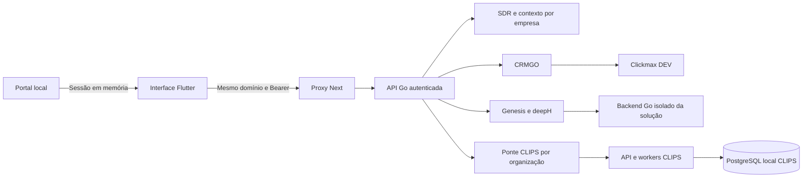

# Arkom local em Flutter

A demo em `/demo` agora usa Flutter para início, mapa, sistemas, BIA SDR, CRM,
CLIPS, contexto da empresa e Genesis. O Next serve os arquivos compilados,
obtém a sessão local e encaminha pedidos para Go. As demais rotas educacionais e
administrativas do portal original continuam na aplicação Next existente.

A referência visual e de navegação é `bilhon-business/arkom-dash`, commit
`82d36ecfffd7ddb73c606c1ce2638e63f9b35325`. O catálogo usa os nomes verificados
nessa fonte e acrescenta o CLIPS já presente neste repositório. Ele reúne 15
entradas verificadas; não é apresentado como inventário completo das 23 soluções.
Dados de aulas, eventos e indicadores comerciais da plataforma antiga não foram
copiados para a demo; os indicadores locais vêm dos serviços existentes.

## Disponibilidade

| Solução | Serviço | Experiência Flutter desta entrega |
| --- | --- | --- |
| BIA SDR | `services/sdr` | Conversas e mensagens, entrada de teste, assumir, pausar e retomar |
| CRM Arkom | `services/crm` + Clickmax DEV | Funis, contatos, oportunidades, cadastro e movimentação |
| CLIPS | `services/core/pilots/clips` | Upload local, corte vertical, estado e download MP4 |
| Genesis | `packages/deeph` + `services/sdr` | Estúdio existente, etapas, código, prévia e traces SSE |
| FinanceAI e demais entradas | Backend ainda não integrado neste repositório | Bloqueadas; sem redirecionamento para uma aplicação externa |

O contrato do catálogo é `services/sdr/demo/ecosystem/catalog.json`. O servidor
acrescenta `implemented`, `configured` e a razão de indisponibilidade. Configuração
não comprova saúde de um serviço: a tela de cada módulo também trata falhas reais.
As rotas de aplicações não implementadas não estão expostas no portal local.
O contexto compartilhado tem visualização em Flutter; a edição completa e as
configurações avançadas dos produtos continuam exigindo migrações específicas.



## Sessão e isolamento

A sessão Arkom permanece em memória no hospedeiro. A ponte só aceita mensagens
da janela pai e da mesma origem. Cada endpoint valida a organização e o papel.
A aplicação gerada pelo Genesis continua em um iframe de origem opaca, sem token.
Ao concluir uma construção compatível, o estúdio prepara seu backend Go
automaticamente. Chamadas aguardam a preparação e são serializadas. Uma resposta
incerta de escrita não é reenviada automaticamente.

O CLIPS recebe um identificador opaco derivado de HMAC da organização, com segredo
privado gerado pelo launcher. O navegador não fornece esse identificador nem
recebe o cookie interno. Lista, consulta e download usam a mesma verificação de
propriedade. O proxy preserva os bytes do upload. O portal limita vídeos a 7 MiB
e cortes a 30 segundos. Transcrição e seleção automática não fazem parte desta
primeira superfície Flutter.

## Executar

```sh
python3 scripts/build-demo.py
python3 scripts/demo.py
```

Use Node 24 no PATH. O build Flutter também pode ser atualizado isoladamente com
`python3 scripts/build-genesis-flutter.py`. A configuração privada fica em `.env`.

Para o CLIPS, configure `ARKOM_CLIPS_LOCAL_ENABLED=true` e
`ARKOM_CLIPS_FFMPEG` com o caminho absoluto de um FFmpeg local. O modo studio do
launcher existente prepara seu PostgreSQL próprio, a API e dois workers. Requer
PostgreSQL 17; `CLIPS_PILOT_PG_BIN` pode indicar outra instalação compatível.

O CRM depende de suas rotas DEV já provisionadas. Se o cluster local precisa ser
iniciado junto, configure `ARKOM_CRM_LOCAL_PG_DATA` com seu diretório existente e
`ARKOM_LOCAL_PG_BIN` com os binários PostgreSQL. A porta e o usuário vêm de
`ARKOM_CRM_DATABASE_URL`, com host `127.0.0.1`. Um servidor já iniciado é preservado;
o launcher encerra apenas os processos que ele próprio criou. Essa opção não
copia nem provisiona o banco da operação.

## Verificação

- Flutter: análise estática, layouts desktop/celular, catálogo bloqueado e imagens de referência.
- JS: sessão, mensagens, conexão da prévia, fila de pedidos e recusa de frames antigos.
- Proxy: origem, rotas, SSE e preservação binária de upload.
- Go: catálogo autenticado, identidade por organização, permissões e rotas CLIPS.
- Integração local: CRM DEV consultado, vídeo sintético enviado pelo portal,
  MP4 realmente gerado e download recusado para outra empresa.

A migração visual é incremental: o início e o mapa reproduzem a organização e o
estilo da referência com dados locais. A paridade de todos os módulos e conteúdos
da plataforma antiga ainda não foi concluída. Essa entrega é local; não publica
os serviços nem os dados na plataforma online.
