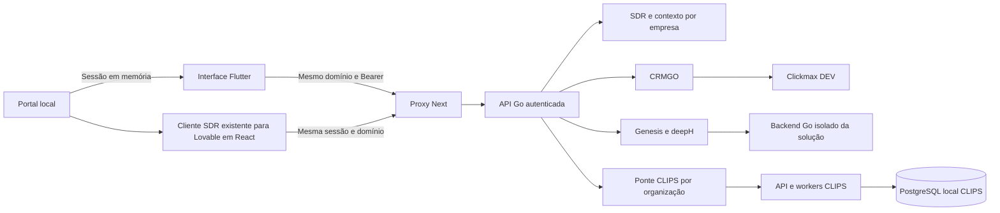
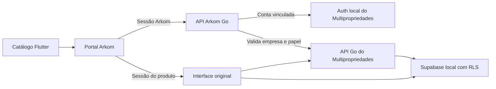

# Arkom local em Flutter

A demo em `/demo` usa Flutter para início, squads, ferramentas do Genesis, mapa,
CRM, CLIPS, contexto da empresa e estúdio Genesis. O SDR abre o cliente completo já preparado para o Lovable,
em React, até que a migração Flutter preserve suas funções. O Next serve os arquivos compilados,
obtém a sessão local e encaminha pedidos para Go. As demais rotas educacionais e
administrativas do portal original continuam na aplicação Next existente.

A referência visual e de navegação é `bilhon-business/arkom-dash`, commit
`82d36ecfffd7ddb73c606c1ce2638e63f9b35325`. O catálogo usa os nomes verificados
nessa fonte e acrescenta CLIPS e Multipropriedades. Ele reúne 16
entradas verificadas; não é apresentado como inventário completo das 23 soluções.
Dados de aulas, eventos e indicadores comerciais da plataforma antiga não foram
copiados para a demo; os indicadores locais vêm dos serviços existentes.

## Disponibilidade

| Solução | Serviço | Experiência desta entrega |
| --- | --- | --- |
| BIA SDR | `services/sdr` | Cliente React existente: WhatsApp, negócio, conversas, automações, execuções, CRM, agendas, dados, auditoria e álbuns |
| CRM Arkom | `services/crm` + Clickmax DEV | Funis, contatos, oportunidades, cadastro e movimentação |
| CLIPS | `services/core/pilots/clips` | Biblioteca e estúdio Flutter para cortes verticais e geração de GIFs por descrição |
| Arkom Multipropriedades | API Go e homologação local no checkout próprio | Operação original incorporada à plataforma |
| Genesis | `packages/deeph` + `services/sdr` | Estúdio existente, etapas, código, prévia e traces SSE |
| FinanceAI e demais entradas | Backend ainda não integrado neste repositório | Bloqueadas; sem redirecionamento para uma aplicação externa |

O contrato do catálogo é `services/sdr/demo/ecosystem/catalog.json`. O servidor
acrescenta `implemented`, `configured` e a razão de indisponibilidade. Configuração
não comprova saúde de um serviço: a tela de cada módulo também trata falhas reais.
As rotas de aplicações não implementadas não estão expostas no portal local.
O contexto compartilhado tem visualização em Flutter; a edição completa e as
configurações avançadas dos produtos continuam exigindo migrações específicas.
O SDR preserva essas telas no cliente existente, com as capacidades efetivamente
habilitadas no backend. Consulte [SDR e Lovable](SDR-PRODUTO-E-LOVABLE.md).



## Sessão e isolamento

A sessão Arkom permanece em memória no hospedeiro. A ponte só aceita mensagens
da janela pai e da mesma origem. Cada endpoint valida a organização e o papel.
A aplicação gerada pelo Genesis continua em um iframe de origem opaca, sem token.
Ao concluir uma construção compatível, o estúdio prepara seu backend Go
automaticamente. Chamadas aguardam a preparação e são serializadas. Uma resposta
incerta de escrita não é reenviada automaticamente.

O CLIPS recebe um identificador opaco derivado de HMAC da organização, com segredo
privado gerado pelo launcher. O navegador não fornece esse identificador nem
recebe o cookie interno. A lista, a consulta, a prévia, o download e a exclusão
verificam a propriedade no serviço Go. O perfil de consulta pode assistir e
baixar. A exclusão fica disponível após o término do processamento.

O estúdio Flutter usa a marca oficial do CLIPS e leva a identidade dos Álbuns
à biblioteca e ao editor. Os projetos novos e anteriores ficam no PostgreSQL
local. O portal aceita MP4 e M4V de até 7 MiB e exporta trechos manuais de até
30 segundos em 720 × 1280 com o worker Go e FFmpeg. Importação por link,
transcrição e seleção de cortes por IA ficam indisponíveis neste ambiente.

**Gerar GIFs** usa a fila Go do CLIPS e o mesmo banco local. A ponte deriva e
assina uma identidade a partir da empresa e da conta autenticada. Cada conta
tem histórico, chave cifrada, saldo e downloads próprios. A conta de teste
Alfa recebe três créditos por 30 dias, provisionados uma vez, usando a chave
OpenAI já configurada no launcher. As demais contas podem cadastrar a própria
chave. Repetir a mesma solicitação preserva o pedido e o saldo já debitado.

## Executar

```sh
python3 scripts/build-demo.py
python3 scripts/demo.py
```

Use Node 24 no PATH. O build Flutter também pode ser atualizado isoladamente com
`python3 scripts/build-genesis-flutter.py`. A configuração privada fica em `.env`.

Para o CLIPS, configure `ARKOM_CLIPS_LOCAL_ENABLED=true` e
`ARKOM_CLIPS_FFMPEG` com o caminho absoluto de um FFmpeg local. O modo studio do
launcher existente prepara seu PostgreSQL próprio, a API e dois workers. Requer
PostgreSQL 17; `CLIPS_PILOT_PG_BIN` pode indicar outra instalação compatível.

O CRM depende de suas rotas DEV já provisionadas. Se o cluster local precisa ser
iniciado junto, configure `ARKOM_CRM_LOCAL_PG_DATA` com seu diretório existente e
`ARKOM_LOCAL_PG_BIN` com os binários PostgreSQL. A porta e o usuário vêm de
`ARKOM_CRM_DATABASE_URL`, com host `127.0.0.1`. Um servidor já iniciado é preservado;
o launcher encerra apenas os processos que ele próprio criou. Essa opção não
copia nem provisiona o banco da operação.

## Verificação

- Flutter: análise estática, layouts desktop/celular, catálogo bloqueado e imagens de referência.
- JS: sessão, mensagens, conexão da prévia, fila de pedidos e recusa de frames antigos.
- Proxy: origem, rotas, SSE e preservação binária de upload.
- Go: catálogo autenticado, identidade por organização, permissões e rotas CLIPS.
- Integração local: CRM DEV consultado, vídeo sintético enviado pelo portal,
  MP4 realmente gerado e download recusado para outra empresa.
- Jornada no Chromium: Seu time → agente → espaço de trabalho e Ferramentas →
  aplicação → edição no Genesis.
- Avaliações: alteração da própria nota, média, persistência após reabrir o banco,
  isolamento por empresa e recusa de escrita para consulta, anônimos e bloqueados.

A migração visual é incremental: o início e o mapa reproduzem a organização e o
estilo da referência com dados locais. A paridade de todos os módulos e conteúdos
da plataforma antiga ainda não foi concluída. Essa entrega é local; não publica
os serviços nem os dados na plataforma online.

## Seu time e Ferramentas

Em **Seu time**, o squad Vendas reúne a BIA SDR e o CRM. Conteúdo reúne a Luma, agente de cortes e GIFs.
Operações reúne a Maia, agente de multipropriedades. BIA, Luma e Maia usam
avatares Gopher e abrem seus espaços de trabalho. A disponibilidade vem do catálogo autenticado.
Os squads organizam o acesso aos módulos existentes.

**Ferramentas** consulta as construções da empresa da sessão. Apresenta a última
versão pronta com interface de cada aplicação do Genesis. Uma revisão em curso
ou com falha mantém acessível a última versão concluída. A aplicação abre na
prévia isolada vinculada ao seu backend Go quando compatível. **Editar no
Genesis** abre a mesma versão no estúdio, conforme o papel da conta.

Os links de detalhes `/demo/systems/{id}` continuam válidos. **Voltar para Seu
time** retorna aos squads. O endereço antigo `/demo/systems` leva a Ferramentas.
O Remix continua pendente para os módulos locais.

As capas e os vídeos privados da plataforma antiga não estão nesta cópia. Esta
entrega usa ilustrações vetoriais nativas em Flutter nos espaços das capas e
indica quando não há tutorial em vídeo. O guia textual descreve o fluxo existente;
suas contagens correspondem aos passos e recursos cadastrados, sem copiar números
de vídeos ou avaliações da plataforma antiga.

A avaliação é armazenada no snapshot SQLite: uma nota de 1 a 5 por pessoa e
sistema, atualizável e isolada por organização. O resumo mostra apenas este
espaço, com estado vazio antes do primeiro voto. O perfil de consulta não altera
notas. Os votos não são incluídos no contexto de construção dos agentes.

## Multipropriedades

Configure `ARKOM_MULTI_HOMOLOG_ROOT` no `.env` privado com o caminho do checkout
do Multipropriedades. Instale as dependências nesse checkout, mantenha Docker
local ativo e execute `python3 scripts/demo.py` na ArkomGO. A rota é
`/demo/systems/multipropriedades` → **Acessar sistema** → `/demo/multipropriedades`.
Abra a plataforma em `http://127.0.0.1:3007`.

A demo inicia a homologação existente, o frontend React original em 8180 e
a API Go em 8190. Supabase Auth e PostgreSQL são locais, em 55321 e 55322. Quando o checkout inclui
o worker Go de captação, a demo também inicia o processamento da fila de triagem
com a conta dedicada da homologação.
O catálogo mostra o sistema disponível quando os serviços respondem e existe
um vínculo para a conta da sessão. O ambiente local verifica quatro vínculos
fictícios. Alfa tem administrador, vendedor e consulta. Beta tem administrador.
As demais contas ficam bloqueadas até terem um vínculo.

O Go valida a sessão Arkom, troca a identidade por uma sessão do Auth local e
confere acesso e papel com a API original do produto. O iframe recebe somente
a sessão do produto. O frontend original mantém seus controles de acesso e
o banco aplica as regras por organização. As credenciais ficam no checkout
privado. O lançador entrega ao produto somente as variáveis do ambiente local.



A interface interna do produto continua em React. O checkout externo e seus
dados permanecem no ambiente local. Remix e provisionamento comercial ainda não
estão configurados nesta integração. Conectores externos de cobrança e assinatura
ficam fora da homologação. Ao parar a demo, a stack Docker e o volume
do produto são preservados. Para parar também os containers, execute
`npm run homolog:stop` no checkout do Multipropriedades.
