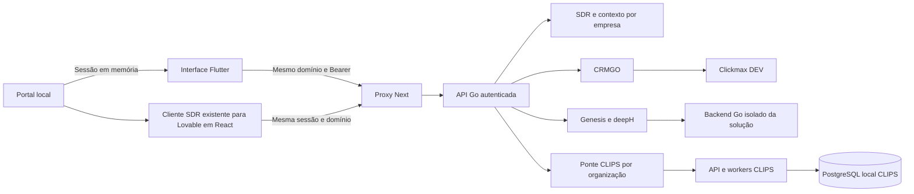

# Arkom local em Flutter

A demo em `/demo` usa Flutter para início, mapa, sistemas, CRM, CLIPS, contexto
da empresa e Genesis. O SDR abre o cliente completo já preparado para o Lovable,
em React, até que a migração Flutter preserve suas funções. O Next serve os arquivos compilados,
obtém a sessão local e encaminha pedidos para Go. As demais rotas educacionais e
administrativas do portal original continuam na aplicação Next existente.

A referência visual e de navegação é `bilhon-business/arkom-dash`, commit
`82d36ecfffd7ddb73c606c1ce2638e63f9b35325`. O catálogo usa os nomes verificados
nessa fonte e acrescenta o CLIPS já presente neste repositório. Ele reúne 15
entradas verificadas; não é apresentado como inventário completo das 23 soluções.
Dados de aulas, eventos e indicadores comerciais da plataforma antiga não foram
copiados para a demo; os indicadores locais vêm dos serviços existentes.

## Disponibilidade

| Solução | Serviço | Experiência desta entrega |
| --- | --- | --- |
| BIA SDR | `services/sdr` | Cliente React existente: WhatsApp, negócio, conversas, automações, execuções, CRM, agendas, dados, auditoria e álbuns |
| CRM Arkom | `services/crm` + Clickmax DEV | Funis, contatos, oportunidades, cadastro e movimentação |
| CLIPS | `services/core/pilots/clips` | Biblioteca e estúdio Flutter com upload, prévia, seleção de trecho, renderização, reprodução, download e exclusão |
| Genesis | `packages/deeph` + `services/sdr` | Estúdio existente, etapas, código, prévia e traces SSE |
| FinanceAI e demais entradas | Backend ainda não integrado neste repositório | Bloqueadas; sem redirecionamento para uma aplicação externa |

O contrato do catálogo é `services/sdr/demo/ecosystem/catalog.json`. O servidor
acrescenta `implemented`, `configured` e a razão de indisponibilidade. Configuração
não comprova saúde de um serviço: a tela de cada módulo também trata falhas reais.
As rotas de aplicações não implementadas não estão expostas no portal local.
O contexto compartilhado tem visualização em Flutter; a edição completa e as
configurações avançadas dos produtos continuam exigindo migrações específicas.
O SDR preserva essas telas no cliente existente, com as capacidades efetivamente
habilitadas no backend. Consulte [SDR e Lovable](SDR-PRODUTO-E-LOVABLE.md).



## Sessão e isolamento

A sessão Arkom permanece em memória no hospedeiro. A ponte só aceita mensagens
da janela pai e da mesma origem. Cada endpoint valida a organização e o papel.
A aplicação gerada pelo Genesis continua em um iframe de origem opaca, sem token.
Ao concluir uma construção compatível, o estúdio prepara seu backend Go
automaticamente. Chamadas aguardam a preparação e são serializadas. Uma resposta
incerta de escrita não é reenviada automaticamente.

O CLIPS recebe um identificador opaco derivado de HMAC da organização, com segredo
privado gerado pelo launcher. O navegador não fornece esse identificador nem
recebe o cookie interno. A lista, a consulta, a prévia, o download e a exclusão
verificam a propriedade no serviço Go. O perfil de consulta pode assistir e
baixar. A exclusão fica disponível após o término do processamento.

O estúdio Flutter usa a marca oficial do CLIPS e leva a identidade dos Álbuns
à biblioteca e ao editor. Os projetos novos e anteriores ficam no PostgreSQL
local. O portal aceita MP4 e M4V de até 7 MiB e exporta trechos manuais de até
30 segundos em 720 × 1280 com o worker Go e FFmpeg. Importação por link,
transcrição, seleção por IA e geração de GIF ficam indisponíveis neste
ambiente.

## Executar

```sh
python3 scripts/build-demo.py
python3 scripts/demo.py
```

Use Node 24 no PATH. O build Flutter também pode ser atualizado isoladamente com
`python3 scripts/build-genesis-flutter.py`. A configuração privada fica em `.env`.

Para o CLIPS, configure `ARKOM_CLIPS_LOCAL_ENABLED=true` e
`ARKOM_CLIPS_FFMPEG` com o caminho absoluto de um FFmpeg local. O modo studio do
launcher existente prepara seu PostgreSQL próprio, a API e dois workers. Requer
PostgreSQL 17; `CLIPS_PILOT_PG_BIN` pode indicar outra instalação compatível.

O CRM depende de suas rotas DEV já provisionadas. Se o cluster local precisa ser
iniciado junto, configure `ARKOM_CRM_LOCAL_PG_DATA` com seu diretório existente e
`ARKOM_LOCAL_PG_BIN` com os binários PostgreSQL. A porta e o usuário vêm de
`ARKOM_CRM_DATABASE_URL`, com host `127.0.0.1`. Um servidor já iniciado é preservado;
o launcher encerra apenas os processos que ele próprio criou. Essa opção não
copia nem provisiona o banco da operação.

## Verificação

- Flutter: análise estática, layouts desktop/celular, catálogo bloqueado e imagens de referência.
- JS: sessão, mensagens, conexão da prévia, fila de pedidos e recusa de frames antigos.
- Proxy: origem, rotas, SSE e preservação binária de upload.
- Go: catálogo autenticado, identidade por organização, permissões e rotas CLIPS.
- Integração local: CRM DEV consultado, vídeo sintético enviado pelo portal,
  MP4 realmente gerado e download recusado para outra empresa.
- Jornada no Chromium: catálogo → detalhes → guia → acesso ao SDR, sem iniciar
  o produto antes do acesso e sem erros JavaScript; identificador inválido recusado.
- Avaliações: alteração da própria nota, média, persistência após reabrir o banco,
  isolamento por empresa e recusa de escrita para consulta, anônimos e bloqueados.

A migração visual é incremental: o início e o mapa reproduzem a organização e o
estilo da referência com dados locais. A paridade de todos os módulos e conteúdos
da plataforma antiga ainda não foi concluída. Essa entrega é local; não publica
os serviços nem os dados na plataforma online.

## Jornada de acesso a um sistema

A galeria abre os detalhes em `/demo/systems/{id}`. O card não inicializa o produto.
A página apresenta o sistema, um guia de uso, os recursos incluídos e a avaliação.
**Acessar sistema** abre o módulo integrado com a sessão do portal; o cliente
não precisa autenticar novamente no ambiente local. Voltar para Sistemas retorna
à galeria. Um identificador desconhecido retorna 404.

Os sistemas sem serviço nesta estrutura continuam bloqueados na galeria. Mesmo
em uma URL direta de detalhes, o botão de acesso fica desativado. O Remix no
Lovable permanece identificado como pendente; não redireciona para um modelo
externo com backend diferente.

As capas e os vídeos privados da plataforma antiga não estão nesta cópia. Esta
entrega usa ilustrações vetoriais nativas em Flutter nos espaços das capas e
indica quando não há tutorial em vídeo. O guia textual descreve o fluxo existente;
suas contagens correspondem aos passos e recursos cadastrados, sem copiar números
de vídeos ou avaliações da plataforma antiga.

A avaliação é armazenada no snapshot SQLite: uma nota de 1 a 5 por pessoa e
sistema, atualizável e isolada por organização. O resumo mostra apenas este
espaço, com estado vazio antes do primeiro voto. O perfil de consulta não altera
notas. Os votos não são incluídos no contexto de construção dos agentes.
