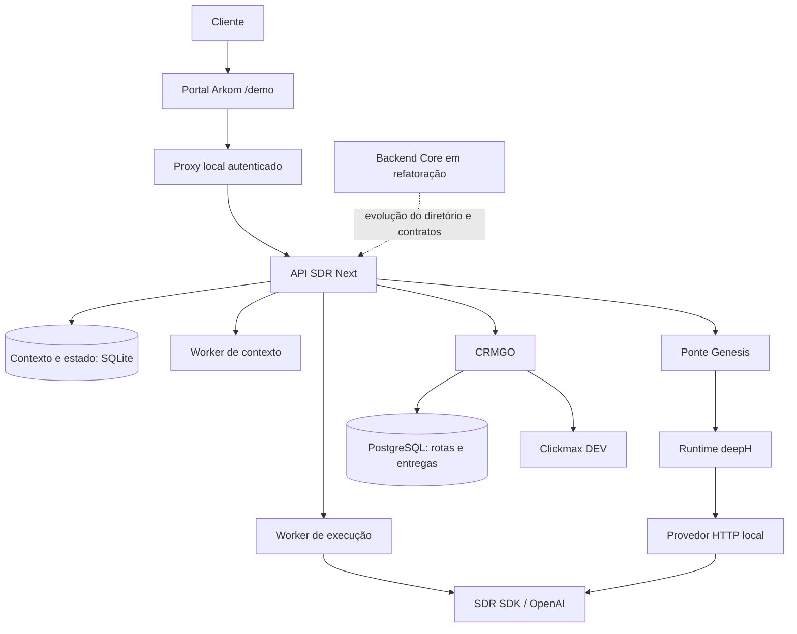

# Diagramas Mermaid

66 diagramas indexados. As fontes anteriores são preservadas; blocos em Markdown também recebem uma cópia `.mmd` editável em `importados/`.

Os diagramas herdados podem representar propostas ou versões anteriores. Consulte a origem e [o estado atual](../STATUS-E-ROADMAP.md) antes de tratá-los como descrição da demo.

Para atualizar: `python3 scripts/catalog_mermaid.py`.

| Diagrama editável | Documento de origem |
| --- | --- |
| [07-genesis-alteracao-go.mmd](../../docs/mermaid/07-genesis-alteracao-go.mmd) | [docs/mermaid/07-genesis-alteracao-go.mmd — bloco 1](../../docs/mermaid/07-genesis-alteracao-go.mmd) |
| [06-runtime-local.mmd](../../docs/mermaid/06-runtime-local.mmd) | [docs/mermaid/06-runtime-local.mmd — bloco 1](../../docs/mermaid/06-runtime-local.mmd) |
| [05-jornada-produto-proposta.mmd](../../docs/mermaid/05-jornada-produto-proposta.mmd) | [docs/mermaid/05-jornada-produto-proposta.mmd — bloco 1](../../docs/mermaid/05-jornada-produto-proposta.mmd) |
| [04-autonomia-proposta.mmd](../../docs/mermaid/04-autonomia-proposta.mmd) | [docs/mermaid/04-autonomia-proposta.mmd — bloco 1](../../docs/mermaid/04-autonomia-proposta.mmd) |
| [03-sdr-crm.mmd](../../docs/mermaid/03-sdr-crm.mmd) | [docs/mermaid/03-sdr-crm.mmd — bloco 1](../../docs/mermaid/03-sdr-crm.mmd) |
| [02-genesis-multiagentes.mmd](../../docs/mermaid/02-genesis-multiagentes.mmd) | [docs/mermaid/02-genesis-multiagentes.mmd — bloco 1](../../docs/mermaid/02-genesis-multiagentes.mmd) |
| [01-demo-integrada.mmd](../../docs/mermaid/01-demo-integrada.mmd) | [docs/mermaid/01-demo-integrada.mmd — bloco 1](../../docs/mermaid/01-demo-integrada.mmd) |
| [apps-README-e1f611f0-01.mmd](../../docs/mermaid/importados/apps-README-e1f611f0-01.mmd) | [apps/portal/README.md — bloco 1](../../apps/portal/README.md) |
| [apps-README-e1f611f0-02.mmd](../../docs/mermaid/importados/apps-README-e1f611f0-02.mmd) | [apps/portal/README.md — bloco 2](../../apps/portal/README.md) |
| [apps-ARQUITETURA-DASH-UNIFICADO-3ba080d0-01.mmd](../../docs/mermaid/importados/apps-ARQUITETURA-DASH-UNIFICADO-3ba080d0-01.mmd) | [apps/portal/docs/ARQUITETURA-DASH-UNIFICADO.md — bloco 1](../../apps/portal/docs/ARQUITETURA-DASH-UNIFICADO.md) |
| [apps-data-flow-c0893093-01.mmd](../../docs/mermaid/importados/apps-data-flow-c0893093-01.mmd) | [apps/portal/documentacao/architecture/data-flow.mdx — bloco 1](../../apps/portal/documentacao/architecture/data-flow.mdx) |
| [apps-data-flow-c0893093-02.mmd](../../docs/mermaid/importados/apps-data-flow-c0893093-02.mmd) | [apps/portal/documentacao/architecture/data-flow.mdx — bloco 2](../../apps/portal/documentacao/architecture/data-flow.mdx) |
| [apps-data-flow-c0893093-03.mmd](../../docs/mermaid/importados/apps-data-flow-c0893093-03.mmd) | [apps/portal/documentacao/architecture/data-flow.mdx — bloco 3](../../apps/portal/documentacao/architecture/data-flow.mdx) |
| [apps-overview-c6f73b5f-01.mmd](../../docs/mermaid/importados/apps-overview-c6f73b5f-01.mmd) | [apps/portal/documentacao/architecture/overview.mdx — bloco 1](../../apps/portal/documentacao/architecture/overview.mdx) |
| [apps-dash-4fe2e4d9-01.mmd](../../docs/mermaid/importados/apps-dash-4fe2e4d9-01.mmd) | [apps/portal/documentacao/components/dash.mdx — bloco 1](../../apps/portal/documentacao/components/dash.mdx) |
| [apps-map-9abb3fe2-01.mmd](../../docs/mermaid/importados/apps-map-9abb3fe2-01.mmd) | [apps/portal/documentacao/components/map.mdx — bloco 1](../../apps/portal/documentacao/components/map.mdx) |
| [apps-overview-0d3e4ca6-01.mmd](../../docs/mermaid/importados/apps-overview-0d3e4ca6-01.mmd) | [apps/portal/documentacao/components/overview.mdx — bloco 1](../../apps/portal/documentacao/components/overview.mdx) |
| [apps-overview-1bdfe75c-01.mmd](../../docs/mermaid/importados/apps-overview-1bdfe75c-01.mmd) | [apps/portal/documentacao/database/overview.mdx — bloco 1](../../apps/portal/documentacao/database/overview.mdx) |
| [apps-overview-b1e01525-01.mmd](../../docs/mermaid/importados/apps-overview-b1e01525-01.mmd) | [apps/portal/documentacao/endpoints/overview.mdx — bloco 1](../../apps/portal/documentacao/endpoints/overview.mdx) |
| [apps-auth-sessao-b42412fa-01.mmd](../../docs/mermaid/importados/apps-auth-sessao-b42412fa-01.mmd) | [apps/portal/documentacao/logic/auth-sessao.mdx — bloco 1](../../apps/portal/documentacao/logic/auth-sessao.mdx) |
| [apps-genesis-builder-5f78af78-01.mmd](../../docs/mermaid/importados/apps-genesis-builder-5f78af78-01.mmd) | [apps/portal/documentacao/logic/genesis-builder.mdx — bloco 1](../../apps/portal/documentacao/logic/genesis-builder.mdx) |
| [apps-overview-f7a125a6-01.mmd](../../docs/mermaid/importados/apps-overview-f7a125a6-01.mmd) | [apps/portal/documentacao/prompts/overview.mdx — bloco 1](../../apps/portal/documentacao/prompts/overview.mdx) |
| [apps-e2e-ea17455f-01.mmd](../../docs/mermaid/importados/apps-e2e-ea17455f-01.mmd) | [apps/portal/documentacao/testing/e2e.mdx — bloco 1](../../apps/portal/documentacao/testing/e2e.mdx) |
| [services-clips-go-integracao-backends-3196c877-01.mmd](../../docs/mermaid/importados/services-clips-go-integracao-backends-3196c877-01.mmd) | [services/core/docs/clips-go-integracao-backends.md — bloco 1](../../services/core/docs/clips-go-integracao-backends.md) |
| [services-clips-go-interface-homologacao-892c56d1-01.mmd](../../docs/mermaid/importados/services-clips-go-interface-homologacao-892c56d1-01.mmd) | [services/core/docs/clips-go-interface-homologacao.md — bloco 1](../../services/core/docs/clips-go-interface-homologacao.md) |
| [services-fluxo-cliente-mermaid-07e73e7f-01.mmd](../../docs/mermaid/importados/services-fluxo-cliente-mermaid-07e73e7f-01.mmd) | [services/core/docs/fluxo-cliente-mermaid.md — bloco 1](../../services/core/docs/fluxo-cliente-mermaid.md) |
| [services-fluxo-cliente-mermaid-07e73e7f-02.mmd](../../docs/mermaid/importados/services-fluxo-cliente-mermaid-07e73e7f-02.mmd) | [services/core/docs/fluxo-cliente-mermaid.md — bloco 2](../../services/core/docs/fluxo-cliente-mermaid.md) |
| [services-fluxo-cliente-mermaid-07e73e7f-03.mmd](../../docs/mermaid/importados/services-fluxo-cliente-mermaid-07e73e7f-03.mmd) | [services/core/docs/fluxo-cliente-mermaid.md — bloco 3](../../services/core/docs/fluxo-cliente-mermaid.md) |
| [services-fluxo-cliente-mermaid-07e73e7f-04.mmd](../../docs/mermaid/importados/services-fluxo-cliente-mermaid-07e73e7f-04.mmd) | [services/core/docs/fluxo-cliente-mermaid.md — bloco 4](../../services/core/docs/fluxo-cliente-mermaid.md) |
| [services-fluxo-cliente-mermaid-07e73e7f-05.mmd](../../docs/mermaid/importados/services-fluxo-cliente-mermaid-07e73e7f-05.mmd) | [services/core/docs/fluxo-cliente-mermaid.md — bloco 5](../../services/core/docs/fluxo-cliente-mermaid.md) |
| [services-fluxo-cliente-mermaid-07e73e7f-06.mmd](../../docs/mermaid/importados/services-fluxo-cliente-mermaid-07e73e7f-06.mmd) | [services/core/docs/fluxo-cliente-mermaid.md — bloco 6](../../services/core/docs/fluxo-cliente-mermaid.md) |
| [services-fluxo-cliente-mermaid-07e73e7f-07.mmd](../../docs/mermaid/importados/services-fluxo-cliente-mermaid-07e73e7f-07.mmd) | [services/core/docs/fluxo-cliente-mermaid.md — bloco 7](../../services/core/docs/fluxo-cliente-mermaid.md) |
| [services-fluxo-cliente-mermaid-07e73e7f-08.mmd](../../docs/mermaid/importados/services-fluxo-cliente-mermaid-07e73e7f-08.mmd) | [services/core/docs/fluxo-cliente-mermaid.md — bloco 8](../../services/core/docs/fluxo-cliente-mermaid.md) |
| [services-fluxo-cliente-mermaid-07e73e7f-09.mmd](../../docs/mermaid/importados/services-fluxo-cliente-mermaid-07e73e7f-09.mmd) | [services/core/docs/fluxo-cliente-mermaid.md — bloco 9](../../services/core/docs/fluxo-cliente-mermaid.md) |
| [services-fluxo-cliente-mermaid-07e73e7f-10.mmd](../../docs/mermaid/importados/services-fluxo-cliente-mermaid-07e73e7f-10.mmd) | [services/core/docs/fluxo-cliente-mermaid.md — bloco 10](../../services/core/docs/fluxo-cliente-mermaid.md) |
| [services-fluxo-cliente-mermaid-07e73e7f-11.mmd](../../docs/mermaid/importados/services-fluxo-cliente-mermaid-07e73e7f-11.mmd) | [services/core/docs/fluxo-cliente-mermaid.md — bloco 11](../../services/core/docs/fluxo-cliente-mermaid.md) |
| [services-fluxo-cliente-mermaid-07e73e7f-12.mmd](../../docs/mermaid/importados/services-fluxo-cliente-mermaid-07e73e7f-12.mmd) | [services/core/docs/fluxo-cliente-mermaid.md — bloco 12](../../services/core/docs/fluxo-cliente-mermaid.md) |
| [services-fluxo-cliente-mermaid-07e73e7f-13.mmd](../../docs/mermaid/importados/services-fluxo-cliente-mermaid-07e73e7f-13.mmd) | [services/core/docs/fluxo-cliente-mermaid.md — bloco 13](../../services/core/docs/fluxo-cliente-mermaid.md) |
| [services-fluxo-cliente-mermaid-07e73e7f-14.mmd](../../docs/mermaid/importados/services-fluxo-cliente-mermaid-07e73e7f-14.mmd) | [services/core/docs/fluxo-cliente-mermaid.md — bloco 14](../../services/core/docs/fluxo-cliente-mermaid.md) |
| [services-fluxo-formulario-agenda-bia-a62bc0e6-01.mmd](../../docs/mermaid/importados/services-fluxo-formulario-agenda-bia-a62bc0e6-01.mmd) | [services/core/docs/fluxo-formulario-agenda-bia.md — bloco 1](../../services/core/docs/fluxo-formulario-agenda-bia.md) |
| [services-fluxo-formulario-agenda-bia-a62bc0e6-02.mmd](../../docs/mermaid/importados/services-fluxo-formulario-agenda-bia-a62bc0e6-02.mmd) | [services/core/docs/fluxo-formulario-agenda-bia.md — bloco 2](../../services/core/docs/fluxo-formulario-agenda-bia.md) |
| [services-fluxo-formulario-agenda-bia-a62bc0e6-03.mmd](../../docs/mermaid/importados/services-fluxo-formulario-agenda-bia-a62bc0e6-03.mmd) | [services/core/docs/fluxo-formulario-agenda-bia.md — bloco 3](../../services/core/docs/fluxo-formulario-agenda-bia.md) |
| [services-genesis-plano-construcao-7b15aca6-01.mmd](../../docs/mermaid/importados/services-genesis-plano-construcao-7b15aca6-01.mmd) | [services/core/docs/genesis-plano-construcao.md — bloco 1](../../services/core/docs/genesis-plano-construcao.md) |
| [services-intro-video-10014d12-01.mmd](../../docs/mermaid/importados/services-intro-video-10014d12-01.mmd) | [services/core/docs/intro-video.md — bloco 1](../../services/core/docs/intro-video.md) |
| [services-management-backend-f077dcba-01.mmd](../../docs/mermaid/importados/services-management-backend-f077dcba-01.mmd) | [services/core/docs/management-backend.md — bloco 1](../../services/core/docs/management-backend.md) |
| [01-visao-geral.mmd](../../services/core/docs/mermaid/01-visao-geral.mmd) | [services/core/docs/mermaid/01-visao-geral.mmd — bloco 1](../../services/core/docs/mermaid/01-visao-geral.mmd) |
| [02-formulario-e-abertura.mmd](../../services/core/docs/mermaid/02-formulario-e-abertura.mmd) | [services/core/docs/mermaid/02-formulario-e-abertura.mmd — bloco 1](../../services/core/docs/mermaid/02-formulario-e-abertura.mmd) |
| [03-contexto-e-midias.mmd](../../services/core/docs/mermaid/03-contexto-e-midias.mmd) | [services/core/docs/mermaid/03-contexto-e-midias.mmd — bloco 1](../../services/core/docs/mermaid/03-contexto-e-midias.mmd) |
| [04-agentes-e-decisoes.mmd](../../services/core/docs/mermaid/04-agentes-e-decisoes.mmd) | [services/core/docs/mermaid/04-agentes-e-decisoes.mmd — bloco 1](../../services/core/docs/mermaid/04-agentes-e-decisoes.mmd) |
| [05-agenda.mmd](../../services/core/docs/mermaid/05-agenda.mmd) | [services/core/docs/mermaid/05-agenda.mmd — bloco 1](../../services/core/docs/mermaid/05-agenda.mmd) |
| [06-followups.mmd](../../services/core/docs/mermaid/06-followups.mmd) | [services/core/docs/mermaid/06-followups.mmd — bloco 1](../../services/core/docs/mermaid/06-followups.mmd) |
| [07-permissao-e-chamada.mmd](../../services/core/docs/mermaid/07-permissao-e-chamada.mmd) | [services/core/docs/mermaid/07-permissao-e-chamada.mmd — bloco 1](../../services/core/docs/mermaid/07-permissao-e-chamada.mmd) |
| [08-conversa-na-ligacao.mmd](../../services/core/docs/mermaid/08-conversa-na-ligacao.mmd) | [services/core/docs/mermaid/08-conversa-na-ligacao.mmd — bloco 1](../../services/core/docs/mermaid/08-conversa-na-ligacao.mmd) |
| [09-controle-e-pos-reuniao.mmd](../../services/core/docs/mermaid/09-controle-e-pos-reuniao.mmd) | [services/core/docs/mermaid/09-controle-e-pos-reuniao.mmd — bloco 1](../../services/core/docs/mermaid/09-controle-e-pos-reuniao.mmd) |
| [10-bloqueios-e-falhas.mmd](../../services/core/docs/mermaid/10-bloqueios-e-falhas.mmd) | [services/core/docs/mermaid/10-bloqueios-e-falhas.mmd — bloco 1](../../services/core/docs/mermaid/10-bloqueios-e-falhas.mmd) |
| [11-botoes-de-demonstracao.mmd](../../services/core/docs/mermaid/11-botoes-de-demonstracao.mmd) | [services/core/docs/mermaid/11-botoes-de-demonstracao.mmd — bloco 1](../../services/core/docs/mermaid/11-botoes-de-demonstracao.mmd) |
| [12-arquitetura-dos-workers.mmd](../../services/core/docs/mermaid/12-arquitetura-dos-workers.mmd) | [services/core/docs/mermaid/12-arquitetura-dos-workers.mmd — bloco 1](../../services/core/docs/mermaid/12-arquitetura-dos-workers.mmd) |
| [13-ciclo-de-evolucao-proposto.mmd](../../services/core/docs/mermaid/13-ciclo-de-evolucao-proposto.mmd) | [services/core/docs/mermaid/13-ciclo-de-evolucao-proposto.mmd — bloco 1](../../services/core/docs/mermaid/13-ciclo-de-evolucao-proposto.mmd) |
| [services-n8n-analysis-2fb22a2b-01.mmd](../../docs/mermaid/importados/services-n8n-analysis-2fb22a2b-01.mmd) | [services/core/docs/n8n-analysis.md — bloco 1](../../services/core/docs/n8n-analysis.md) |
| [services-orquestracao-agentes-proposta-32606ec3-01.mmd](../../docs/mermaid/importados/services-orquestracao-agentes-proposta-32606ec3-01.mmd) | [services/core/docs/orquestracao-agentes-proposta.md — bloco 1](../../services/core/docs/orquestracao-agentes-proposta.md) |
| [services-plataforma-cadastro-comum-0d09b860-01.mmd](../../docs/mermaid/importados/services-plataforma-cadastro-comum-0d09b860-01.mmd) | [services/core/docs/plataforma-cadastro-comum.md — bloco 1](../../services/core/docs/plataforma-cadastro-comum.md) |
| [services-plataforma-entrada-remix-0c930bbc-01.mmd](../../docs/mermaid/importados/services-plataforma-entrada-remix-0c930bbc-01.mmd) | [services/core/docs/plataforma-entrada-remix.md — bloco 1](../../services/core/docs/plataforma-entrada-remix.md) |
| [services-specialists-eebdeda4-01.mmd](../../docs/mermaid/importados/services-specialists-eebdeda4-01.mmd) | [services/core/docs/specialists.md — bloco 1](../../services/core/docs/specialists.md) |
| [services-workers-7423f93b-01.mmd](../../docs/mermaid/importados/services-workers-7423f93b-01.mmd) | [services/core/docs/workers.md — bloco 1](../../services/core/docs/workers.md) |
| [services-README-938ad1eb-01.mmd](../../docs/mermaid/importados/services-README-938ad1eb-01.mmd) | [services/core/pilots/clips/README.md — bloco 1](../../services/core/pilots/clips/README.md) |
| [packages-CHAT_CODEX_LEVEL_ARCHITECTURE-820f305d-01.mmd](../../docs/mermaid/importados/packages-CHAT_CODEX_LEVEL_ARCHITECTURE-820f305d-01.mmd) | [packages/deeph/docs/CHAT_CODEX_LEVEL_ARCHITECTURE.md — bloco 1](../../packages/deeph/docs/CHAT_CODEX_LEVEL_ARCHITECTURE.md) |

## Visão integrada da demo

