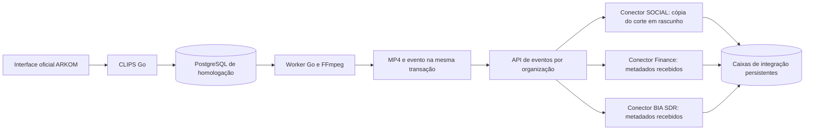

# CLIPS Go — acesso próprio e comunicação entre os novos backends

## Situação em 06/11/2026

O release `r-97a4bc6226ae` está publicado em homologação. O teste no endereço público confirmou login local, recarga, exportação de MP4 e saída. Os três conectores confirmaram o recebimento do corte. [Entrar no CLIPS Go](https://clipsgo-homolog.24-199-100-186.sslip.io/login).

A conta `aluno@bilhon.com` foi provisionada como membro da organização de homologação `bilhon-homolog`, com workspace próprio.

## Acesso e organização

O diretório comum foi publicado no CLIPS Go e recebeu o vínculo do workspace de teste. A aplicação do diretório aos acessos e a adoção pelos outros backends aguardam ativação. [Cadastro comum entre produtos](plataforma-cadastro-comum.md).

O Go mantém credenciais próprias com hash PBKDF2 e sessões em cookie Secure/HttpOnly. O navegador identifica o modo de autenticação pelo domínio habilitado, sem consultar a existência de um e-mail individual. Contas locais habilitadas entram pelo Go, sem enviar senha ao Supabase. O fluxo já existente das contas de origem continua verificando a identidade no Auth central antes de emitir uma sessão Go.

Cada conta tem acesso explícito à solução e à organização. A sessão verifica esses acessos a cada consulta. O identificador da organização da plataforma é separado do identificador do workspace do CLIPS. Antes de ligar outros produtos, é necessário mapear essa organização à organização local de cada backend. Compartilhar esse identificador não concede automaticamente acesso às outras soluções nem implementa login único entre elas.

## Comunicação preparada



Os conectores são uma nova camada de integração da homologação, com esquema e credencial de banco próprios. Os processos e bancos atuais de Finance, BIA/SDR e SOCIAL não foram alterados. Ainda falta ligar as caixas de integração às funções de negócio e às interfaces desses produtos. Não há publicação automática em rede social, cobrança, envio de mensagens ou compartilhamento automático de usuários.

O primeiro fluxo transfere um corte concluído do CLIPS para um rascunho do SOCIAL. O conector copia e verifica o MP4 antes de confirmar o recebimento. Finance e BIA/SDR recebem somente os metadados do evento. As confirmações permitem repetir entregas após uma falha sem duplicar os registros. A exclusão do projeto de origem espera as confirmações dos conectores habilitados; a cópia recebida pelo SOCIAL permanece disponível depois da exclusão.

Cada serviço usa uma credencial exclusiva e permissões explícitas de leitura, publicação e acesso a mídia por organização. O servidor armazena somente o hash dessas credenciais. O cookie de um cliente não autoriza operações entre serviços. Uma credencial de Finance não pode ler o vídeo reservado ao SOCIAL nem publicar eventos em nome do CLIPS.

## Validação e publicação

Os testes locais cobriram login próprio sem chamadas ao Supabase, recarga, saída, credenciais incorretas, revogação de acesso e isolamento entre clientes. O fluxo existente também foi verificado com GoTrue real em laboratório. A interface oficial passou nos 484 testes existentes, no guard do design system e na verificação de tipos. A tela de login, o tema e os arquivos de marca foram preservados.

A renderização e a entrega foram testadas com PostgreSQL descartável e FFmpeg, incluindo reinício após falha na confirmação, repetição de eventos, recusa entre organizações e preservação da cópia do SOCIAL. Os testes Go com detector de concorrência e `go vet` passaram. Esses resultados locais não equivalem à validação da conta real no endereço publicado.

O pacote pode ser preparado sem qualquer conexão ao servidor:

```sh
python3 pilots/clips/deploy/update.py --prepare-only
```

O arquivo e seu hash ficam em `.local/clips-deployment/prepared-release.json`. O registro do release publicado só muda após uma atualização remota bem-sucedida. Com o SSH restabelecido, a sequência é publicar o release, criar a conta via entrada padrão, provisionar as credenciais dos conectores e executar a validação pública com login e exportação. Nenhuma senha deve ser passada como argumento de comando ou gravada em arquivo.

O alcance do piloto continua limitado ao [escopo da interface de homologação](clips-go-interface-homologacao.md). Este trabalho não migra o histórico dos clientes nem habilita os recursos ainda ausentes da operação completa do CLIPS.
