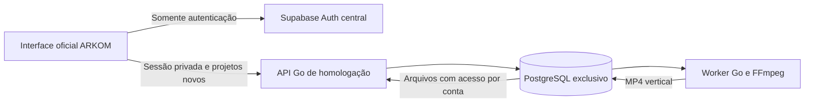

# CLIPS Go — interface oficial em homologação

Endereço: [entrar no CLIPS Go](https://clipsgo-homolog.24-199-100-186.sslip.io/login).

Atualizado em 06/11/2026 para o release `r-97a4bc6226ae`, com `r-4452ffb375eb` disponível para retorno. A publicação preservou o contêiner do banco e os 25 contêineres das outras soluções.

Esta entrega conecta a interface oficial ARKOM ao cadastro individual do CLIPS Go. Contas de origem autenticam no Supabase central, enquanto a conta de teste `aluno@bilhon.com` autentica diretamente no Go. O Go e o PostgreSQL próprio controlam as sessões, os projetos novos e os arquivos das contas habilitadas.

## O que funciona nesta homologação

- Login, recarga com sessão válida e saída da conta, preservando as sessões das outras soluções.
- Listagem dos projetos criados neste ambiente, por conta.
- Upload de MP4 de até 7 MiB, seleção manual de um trecho de 1 a 30 segundos e renderização em 720 × 1280.
- Acompanhamento do processamento, reprodução do resultado e download do MP4.
- Exclusão de um projeto próprio após o processamento terminar.
- Consulta do próprio cadastro na aba Equipe, sem permissão administrativa derivada automaticamente.

O histórico anterior não foi migrado. Importação do YouTube/Drive, transcrição, legendas automáticas, seleção por IA, tracking, reanálise, novos estilos de exportação e pacote para editor ainda não estão disponíveis neste endereço. A interface informa os limites; os controles não suportados são desabilitados ou omitidos apenas neste modo. Não há execução alternativa automática no sistema atual.

O cliente ainda não realizou um login interativo observado por nós. A integração não comprova que a senha digitada no incidente original estava correta e não equivale à migração completa da operação.

## Interface preservada

A origem é `Bilhon-OS/arkom-clips`, commit `f44b29e60c355e397c95d4360083a10b9f7ec113`. A tela de login, o CSS do tema, os tokens Tailwind, o HTML e os arquivos de marca continuam sem alterações. Foram reutilizados os componentes e as páginas do aplicativo. As adaptações de comportamento são condicionadas ao build `clips-go`; o build padrão conserva seu destino original.

O patch completo está em [interface-go.patch](../pilots/clips/interface-go.patch). O checkout de trabalho fica em `.local/arkom-clips-go-interface`, fora do repositório principal. As evidências de teste ficam em `.local/clips-interface-test` e as da publicação em `.local/clips-deployment`.

## Separação dos serviços



As consultas de dados da interface usam o mesmo hostname da API. Nenhuma consulta de projetos, membership, configurações, Storage ou Edge Functions é encaminhada ao Supabase de produção. Operações não implementadas recebem recusa local explícita. A resolução da organização usa o workspace já cadastrado, sem claim de instância ou escolha da primeira membership em produção.

O navegador recebe apenas a chave pública do provedor de identidade. Senha do banco e token técnico da equipe não entram no build. O backend valida a sessão de origem antes de emitir o cookie privado. Metadados e arquivos são filtrados pela conta no servidor; trocar o ID de um projeto não altera essa autorização. As URLs de mídia continuam exigindo o cookie, inclusive após serem obtidas pela API de compatibilidade com o SDK.

A sessão Go dura uma hora. A integração consulta a validade ao receber a sessão do Auth e renova quando restam menos de dez minutos. O logout local invalida o cookie Go e encerra apenas a sessão de origem deste navegador. Se o pedido de logout Go falhar, a interface informa a falha e conserva o estado autenticado, em vez de afirmar que a saída terminou.

Cadastro público e recuperação/alteração de senha não escrevem no Auth central por esta homologação. O cliente deve usar seu canal atual para essas operações.

## Verificações

O fluxo completo foi executado em navegador com a tela oficial, uma conta fictícia no Supabase Auth GoTrue real, PostgreSQL descartável, Go e FFmpeg. Foram verificados senha errada, login correto, recarga, envio, geração, reprodução, download, exclusão e logout. Outro projeto de outra conta foi recusado nas consultas, na leitura do arquivo e na exclusão. O teste também cobriu falha de conexão durante a saída, recusa de operações técnicas e visualização em 390 px sem transbordamento horizontal.

Os 484 testes existentes da interface, o guard do design system, a verificação de tipos, os testes Go com detector de concorrência e `go vet` passaram. O teste local não enviou consultas de dados à produção nem utilizou a senha do cliente.

A publicação é verificada separadamente por `verify-public-interface.mjs`, com certificado TLS validado, carregamento do login e dos assets, redirecionamento de visitante sem sessão e recusa das APIs e arquivos privados. Essa verificação pública não entra na conta do cliente.

## Reprodução e operação

Preparar um checkout privado da origem no commit indicado, aplicar o patch e instalar as dependências conforme o lockfile. O builder usa configuração explícita para o Auth central e recusa o endereço de teste no resultado final.

```sh
python3 pilots/clips/deploy/build-interface.py
CGO_ENABLED=0 GOOS=linux GOARCH=amd64 go build -trimpath -o .local/clips-go-hosted ./pilots/clips
python3 pilots/clips/deploy/update.py
node pilots/clips/deploy/verify-public-interface.mjs
```

Para repetir o teste local completo, preparar os binários descritos no [guia do piloto](../pilots/clips/README.md) e executar:

```sh
python3 pilots/clips/verify-identity-local.py .local/arkom-clips-go-interface
```

A interface é incluída na mesma imagem da API, em `/srv/clips-ui`. A identificação do release considera tanto o binário quanto os arquivos do frontend. A atualização faz backup e substitui somente API e worker de homologação. O banco, o volume e os demais containers são preservados. O hostname e a configuração compartilhada do Caddy não precisam mudar para esta publicação.

Backups incluem a tabela de projetos do aplicativo, a fila e os arquivos no mesmo snapshot. Os limites de armazenamento, a cópia externa dependente deste Mac e os procedimentos de retorno permanecem no [guia operacional](../pilots/clips/deploy/README.md).
