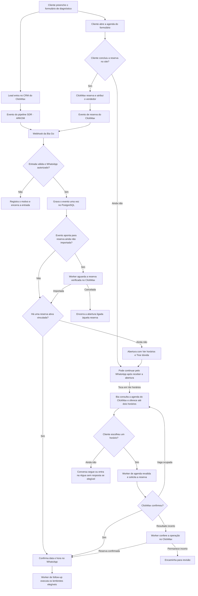
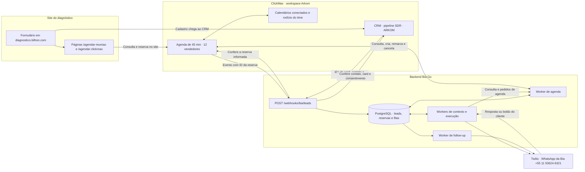
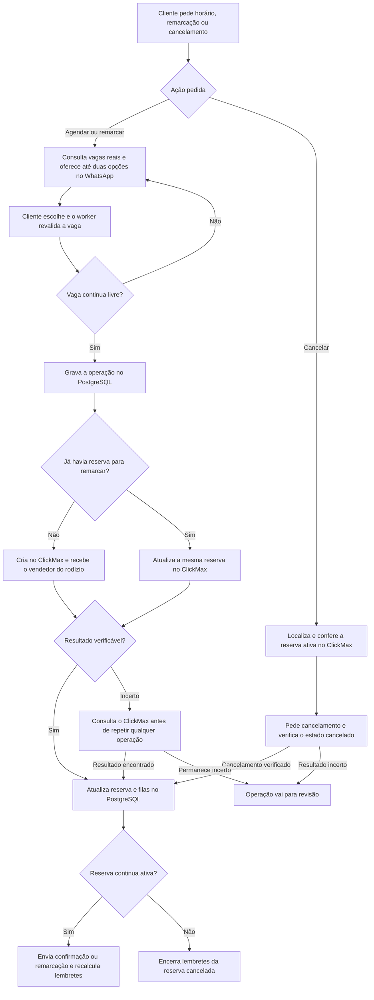

# Bia Go — formulário, WhatsApp e agenda

Estado da operação interna da Arkom em 10/11/2026. As duas páginas de agendamento do diagnóstico usam a agenda **Diagnóstico de IA + 1 Sistema de IA Grátis** no workspace Arkom. A agenda tem reuniões de **45 minutos** e mantém os **12 vendedores**, os calendários conectados e os pesos do rodízio do ClickMax.

## 1. Jornada do cliente

Os eventos do pipeline que entram nessa integração são **Novo Lead**, **Reagendamento** e **Tentativas 1, 2 e 3**. O caminho pelo pipeline pode iniciar o contato enquanto a pessoa ainda está escolhendo uma vaga. Quando já existe uma reserva válida, a Bia usa essa informação para confirmar o horário. Se a abertura com data e hora já cobriu a confirmação, o backend suprime a mensagem redundante.

No teste da Ana, final **1844**, o card entrou primeiro. A Bia abriu a conversa pelo **+55 11 93624-6321**, com **Ver horários** e **Tirar dúvida**. A Twilio confirmou a entrega da abertura e do vídeo. Esse teste comprovou a entrada pelo CRM até o WhatsApp. A reserva pelo botão era o próximo passo.

## 2. Formulário, backend e ClickMax

O navegador usa a agenda pública do ClickMax. O evento que liga a reserva ao backend vem do ClickMax e chega autenticado a `POST https://sdk.arkom.ai/webhooks/bia/leads`. A API consulta o ClickMax para validar o evento e enfileira o trabalho no PostgreSQL. O `202` indica que a entrada foi recebida pelo backend. A entrega ao WhatsApp é registrada à parte pelo retorno da Twilio.

Desde 11/11, a faixa de vagas das duas páginas acompanha o seletor de fuso do calendário. A escolha altera a hora exibida e preserva o instante da reserva. O evento do ClickMax não inclui o fuso selecionado. Quando o Go não tem um fuso no cadastro, as confirmações do ClickMax usam o horário de Brasília com rótulo explícito.

| Responsável | O que gerencia |
| --- | --- |
| Formulário | Coleta o cadastro e abre a página de agendamento da rota do cliente. |
| ClickMax | Mantém a agenda comercial, disponibilidades, equipe, rodízio e reserva confirmada. Para novas reservas da Bia, recebe o horário e escolhe o vendedor elegível. |
| Worker de agenda | Consulta vagas, revalida o horário escolhido, chama o ClickMax e confere o resultado. Importa e reconcilia alterações nas reservas. |
| PostgreSQL | Guarda a conversa, a referência da reserva do ClickMax, o horário, o vendedor e os trabalhos pendentes. Identifica repetições pelo card, reserva ou operação. |
| Workers de contexto e execução | Recebem mensagens e botões, consultam a reserva, apresentam horários e enfileiram pedidos ao worker de agenda. |
| Workers de follow-up, mídia e voz | Enviam lembretes e executam áudio ou ligação nas condições de cada canal. |
| Twilio | Entrega o WhatsApp pelo número da Bia e devolve o estado de entrega. |

O Google entra pela agenda conectada dos vendedores no ClickMax. Nesse caminho, a Bia usa a agenda do time e o rodízio configurado no ClickMax para as novas reservas. A distribuição por menor número de reuniões futuras precisaria ser uma regra do rodízio da agenda ou uma mudança específica na integração.

## 3. O que acontece quando a Bia mexe na agenda

- **Agendamento.** A Bia oferece até duas vagas reais no WhatsApp. A escolha é revalidada antes da criação. A confirmação usa a reserva retornada pelo ClickMax.
- **Remarcação.** O worker atualiza a mesma reserva no ClickMax. O horário anterior segue reservado até o ClickMax aceitar o novo. Depois o Go encerra os lembretes pendentes do horário anterior e calcula os do novo.
- **Cancelamento.** O worker confirma o cancelamento no ClickMax antes de baixar a reserva no Go. Uma abertura aguardando aquela reserva também sai da fila.
- **Alteração feita no ClickMax.** A sincronização do worker consulta a agenda periodicamente e importa alterações verificadas. Se a operação ficar incerta após um timeout, o worker procura a reserva pelo identificador ou pelo registro da operação.

## 4. Réguas que dependem da agenda

| Momento | Ação programada |
| --- | --- |
| Cadastro sem reserva | Abertura com botões e vídeo de apresentação quando elegível. |
| Sem resposta e sem reserva | Follow-ups em +15 min, +2 h, +6 h, +24 h, +48 h e +72 h, sujeitos à janela de contato. |
| Reserva confirmada | Confirmação com data e hora. Fora da janela de atendimento, a confirmação usa o modelo de utilidade aprovado. |
| 15 min após a abertura | Preparação quando existe reunião ativa e ainda há tempo antes da régua final. |
| 24 h, 2 h e 1 h antes | Lembretes de WhatsApp quando ainda cabem na régua. |
| 30 min antes | Áudio quando há janela de atendimento aberta e o arquivo está disponível. |
| 15 min antes | Mensagem e fluxo de autorização. A ligação depende de permissão válida no WhatsApp. |
| 5 min antes | Lembrete no WhatsApp. SMS depende de consentimento separado. |
| Na hora | Aviso de início quando aplicável. O check-in automático de 7 min após o início foi desativado em 11/11. |

Cada envio passa pelas regras vigentes de consentimento, horário, atendimento humano, estado da reserva e janela do canal. A fila mostra o que foi programado e a Twilio informa o que foi efetivamente entregue.

Antes de um follow-up comercial, a Bia consulta os cards atuais do contato no ClickMax. Negociação, fechamento, reunião realizada e ganho bloqueiam o disparo automático dessas réguas.
