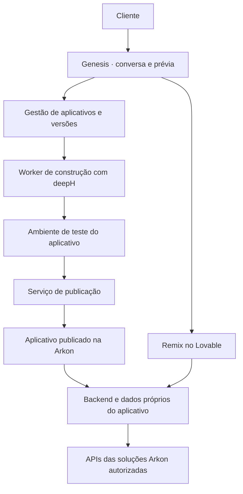

**Plano de construção do Genesis com deepH**

Proposta de produto e implementação, preparada em 08/11/2026 a partir do código local da Arkon, deepH, SDR Next e FinanceAI Core. As decisões de arquitetura abaixo são propostas para o primeiro piloto. O levantamento local identifica componentes e contratos existentes, com validações publicadas na documentação dos projetos. A disponibilidade de cada integração será confirmada na preparação do piloto.

**1. O resultado que queremos entregar**

O cliente descreve uma necessidade e recebe um aplicativo novo, com interface, dados, regras e automações próprios. O Genesis constrói e modifica esse aplicativo usando o deepH. A Arkon hospeda o backend e disponibiliza as capacidades das suas 23 soluções conforme a necessidade e o acesso do cliente.

Exemplo de referência para o piloto, proposto a partir desta conversa. Um cliente trabalha com leilões e pede um sistema para encontrar oportunidades, anunciar lotes e acompanhar o resultado das arrematações. O Genesis cria o domínio de leilões e usa capacidades do Finance para a parte financeira. Depois, o cliente pede para incluir transporte e comissão no cálculo de uma compra. O Genesis altera a interface, a estrutura de dados e a regra de cálculo daquele aplicativo.

O cliente controla aparência, campos, regras, automações, equipe e dados do aplicativo pela conversa. A operação de servidores, a publicação das versões e o acesso aos serviços compartilhados ficam sob gestão da Arkon. A autorização para alterar um aplicativo é limitada ao ambiente e às permissões desse aplicativo.

**2. Como o cliente cria e muda uma solução**

| Momento | Experiência do cliente | Trabalho do Genesis |
| --- | --- | --- |
| Pedir | Escreve o que precisa e pode trazer um exemplo | Identifica objetivo, pessoas que usarão o aplicativo e resultado esperado |
| Esclarecer | Responde perguntas concretas, uma por vez, quando necessárias | Resolve decisões que mudam o produto, como onde buscar leilões e quem pode anunciar |
| Criar | Vê uma descrição curta da primeira versão e escolhe Criar solução | Prepara o projeto, escolhe capacidades e inicia a construção |
| Acompanhar | Vê mensagens como Montando suas telas e Testando seu aplicativo | Mostra etapas confirmadas pela execução |
| Experimentar | Usa uma prévia com exemplos identificados e pede ajustes | Exercita o funcionamento em ambiente separado |
| Ativar | Escolhe Começar a usar e conclui conexões pessoais necessárias | Publica, registra o acesso e prepara os dados reais |
| Usar | Encontra o aplicativo em Minhas soluções | Mantém o aplicativo disponível e acompanha falhas |
| Mudar | Usa Pedir uma mudança dentro do aplicativo | Cria uma nova versão, testa e apresenta a prévia da alteração |
| Publicar mudança | Escolhe Usar esta versão | Aplica a versão validada e as alterações de dados compatíveis |
| Personalizar no Lovable | Escolhe Fazer remix e autoriza sua conta quando necessário | Prepara a cópia, o vínculo com a Arkon e o acesso ao editor |

A experiência inicial oferece a conversa, a prévia e uma ação principal por etapa. Detalhes de construção e do time de agentes ficam disponíveis para a equipe Arkon. O cliente escolhe resultados de negócio. Perguntas técnicas são resolvidas com padrões da plataforma.

Alterações que retiram dados apresentam uma consequência concreta antes da aplicação, como “Apagar este cadastro também remove 12 anúncios”. Rascunhos e ajustes de prévia podem ser feitos continuamente. Falhas recuperáveis são corrigidas dentro do orçamento de tentativas e o progresso é informado de forma simples.

**3. O que já pode ser aproveitado**

| Componente observado | Uso no Genesis | Trabalho de adaptação |
| --- | --- | --- |
| deepH com agentes em YAML, crews, dependências, handoffs tipados, orçamento de contexto e trace | Organizar tarefas de construção e passar contratos entre agentes | Criar crews de aplicativos e uma interface estável para execuções gerenciadas |
| Daemon local do deepH com Run e Trace | Executar builds por um processo controlado | Fixar versão do protocolo, encapsular em worker isolado e acrescentar eventos/checkpoints necessários |
| Diretório comum de empresas, pessoas, produtos, permissões e instalações | Vincular aplicativos ao dono e aos serviços autorizados | Evoluir catálogo fixo para soluções registradas e aplicativos dinâmicos |
| API de eventos entre soluções, confirmações e escopo por organização | Entregar eventos entre aplicativos e serviços | Versionar contratos e ligar consumidores às ações reais de cada produto |
| SDR Next com configurações, rascunhos, publicação e histórico | Referência para mudanças e automações por cliente | Extrair contratos realmente comuns e manter as regras específicas no produto |
| FinanceAI com API, filas persistentes, workers e cliente de interface | Serviço financeiro reutilizável por aplicativos novos | Selecionar operações públicas e verificar modo de execução, permissões e homologação |
| CLIPS com pacote de interface, instalações e entrada autenticada | Referência para entregar uma interface conectada à Arkon | Generalizar o vínculo para aplicativos criados pelo Genesis |

As referências locais estão no [runtime deepH](/Users/tomlisboa/Desktop/Data/deepH/internal/runtime/engine.go), [daemon](/Users/tomlisboa/Desktop/Data/deepH/cmd/deeph/daemon.go), [diretório](/Users/tomlisboa/Desktop/Arkon/internal/platformdirectory/model.go), [eventos](/Users/tomlisboa/Desktop/Arkon/pkg/solutionbus/client.go), [contrato SDR Next](/Users/tomlisboa/Desktop/sdr-next-pilot/delivery/platform-contract.md), [FinanceAI Core](/Users/tomlisboa/Desktop/financeai-core/README.md) e [entrada Remix do CLIPS](/Users/tomlisboa/Desktop/Arkon/docs/plataforma-entrada-remix.md).

Há um limite concreto a migrar. `ValidSolution`, restrições no SQL do diretório e a tabela de clientes de integração aceitam quatro nomes fixos. O registro também limita cada pedido a quatro produtos. A evolução precisa atualizar essas regras em conjunto e preservar os vínculos e permissões já cadastrados. [Validação de soluções](/Users/tomlisboa/Desktop/Arkon/pkg/platformaccess/types.go) · [Registro](/Users/tomlisboa/Desktop/Arkon/internal/platformdirectory/model.go) · [Schema do diretório](/Users/tomlisboa/Desktop/Arkon/internal/platformdirectory/schema.sql) · [Schema de integração](/Users/tomlisboa/Desktop/Arkon/internal/solutionbus/schema.sql)

A lista oficial completa das 23 soluções e a implementação atual do portal/Genesis ainda precisam ser localizadas e conferidas. O plano contempla todas por meio de um contrato comum de integração. Cada solução entra no catálogo com seu estado real de disponibilidade.

**4. Organização proposta da plataforma**



O serviço Genesis mantém conversa, especificação, pedidos de mudança, versões e estado das construções. O worker de construção chama o deepH dentro do ambiente atribuído ao aplicativo. Um serviço de publicação recebe artefatos validados, prepara o ambiente e ativa a versão.

O aplicativo publicado atende usuários com seu próprio backend. Filas, tarefas agendadas e chamadas aos serviços Arkon funcionam independentemente das sessões de construção. Quando o produto precisa de IA durante o uso, essa execução tem contrato, permissões e consumo próprios.

Proponho Go para os serviços centrais e o backend gerado inicial, PostgreSQL para persistência e React com TypeScript para a interface. Essa escolha acompanha os projetos examinados e favorece a entrega ao Lovable. A compatibilidade exata da interface será comprovada na primeira integração.

Cada aplicativo começa com ambiente de execução isolado, banco PostgreSQL próprio e credencial restrita. Um cluster gerenciado pode hospedar vários bancos. Prévia e produção recebem dados e acessos separados. Arquivos ficam em armazenamento com autorização por aplicativo. CPU, memória, tarefas e consumo de provedores recebem limites por instalação.

A execução do código gerado exige isolamento de processo, rede e credenciais, tanto durante a construção quanto em produção. O piloto deve operar em um host de execução separado dos serviços centrais, com usuário restrito, limites e chamadas externas controladas. O executor e o publicador usam permissões distintas. O código do aplicativo acessa suas próprias estruturas de dados e integrações autorizadas.

**5. Como as 23 soluções ficam disponíveis para construir algo novo**

Criar um registro versionado de capacidades junto aos contratos das soluções em refatoração. Cada entrada descreve função, dados de entrada/saída, autenticação, papéis, efeitos, disponibilidade, custo medido ou regra de cobrança, limites, modo de teste e responsável técnico. O nome da solução e a capacidade são referências independentes, permitindo vários serviços por produto.

Exemplos de nomes propostos são `finance.payables.create`, `finance.reports.read` e `whatsapp.messages.send`. Esses nomes serão conciliados com as APIs reais. O cadastro distingue desenvolvimento, teste, homologação e produção. A habilitação depende da disponibilidade do backend e dos direitos da empresa e da pessoa.

O Genesis recebe apenas as capacidades relevantes para o pedido. Um novo aplicativo usa esses contratos para chamar as soluções. O backend do aplicativo contém as regras particulares do mercado, como lote, comissão de leiloeiro e custo de transporte. Uma ampliação do Finance compartilhado segue sua própria publicação de produto pela equipe Arkon.

O acesso entre serviços precisa ser limitado por empresa, aplicativo e operação. A identidade verificada acompanha o pedido e os resultados assíncronos. Revogação e limites são conferidos no servidor. Uma interface copiada recebe acesso depois da verificação do responsável e da instalação.

Cada refatoração entrega seu contrato de integração, exemplos, erros documentados e um teste de uso por um aplicativo externo. Dessa forma, as 23 soluções podem aderir gradualmente ao mesmo padrão enquanto o Genesis é construído.

**6. Como o deepH constrói o aplicativo**

O time é composto por papéis configurados conforme o trabalho. Uma mudança de cor pode usar um único construtor. Uma função nova envolvendo dados e integração usa o fluxo completo.

| Papel | Entrega verificável |
| --- | --- |
| Planejador | Objetivo, usuários, fluxos, critérios de aceite e capacidades necessárias |
| Projetista do aplicativo | Modelo de dados, contrato da API, telas e versão das dependências |
| Construtor de backend | Regras, persistência, migrações e testes das operações |
| Construtor de interface | Telas e estados de uso ligados ao contrato da API |
| Integrador | Conexões com serviços Arkon e fontes externas necessárias |
| Verificador | Testes funcionais, análise das mudanças e evidências da prévia |

Fluxo inicial sugerido no formato do deepH, com os nomes de agentes a criar.

```text
planner > app_designer > backend_builder + frontend_builder > integrator > verifier
```

O contrato da API precede a construção paralela. Cada construtor escreve em áreas próprias do projeto ou produz um patch isolado. A integração combina as entregas e resolve conflitos antes de testar. Os handoffs incluem referências para arquivos completos, resultados de testes e decisões. Textos resumidos servem como orientação, com os contratos completos acessíveis como artefatos.

O `reviewflow` existente pode revisar a parte Go. A verificação da interface acrescenta build, análise de tipos e testes dos percursos no navegador. Um erro gera uma tarefa de correção com evidência e limite de tentativas. Cada execução registra a versão do deepH, agentes, ferramentas, provedor/modelo, alterações e consumo conhecido. [Crew existente](/Users/tomlisboa/Desktop/Data/deepH/crews/reviewflow.yaml)

A integração inicial pode encapsular o daemon existente dentro do worker isolado. O processo central acessa um contrato privado de jobs. O worker atribui diretório, credenciais temporárias e capacidades. A interface do cliente transmite pedidos de produto, e o backend resolve caminhos e comandos.

A durabilidade fica no serviço de jobs do Genesis. Cada etapa concluída registra artefatos, versão-base e um checkpoint. Após reinício, o worker retoma da última etapa concluída e verifica se resultados pendentes já foram aplicados. Eventos de progresso, cancelamento e checkpoints devem ser acrescentados ao adaptador do deepH conforme necessário. O orçamento inclui chamadas, tempo, tokens e correções. A estimativa exibida ao cliente vem de execuções medidas.

**7. O que cada aplicativo precisa guardar**

| Registro | Finalidade |
| --- | --- |
| Aplicativo | Dono, organização, nome, estado, acesso e limites |
| Especificação | Objetivo, fluxos, pessoas, regras e decisões do cliente |
| Versão | Código, contrato da API, estrutura de dados, migrações e dependências |
| Construção | Pedido, versão-base, tarefas, checkpoints, custos e resultado |
| Ambiente | Prévia ou produção, backend, banco, arquivos e configuração |
| Instalação | Interface, domínio verificado, login e backend autorizado |
| Concessão | Capacidades Arkon que o aplicativo pode utilizar |
| Publicação | Artefato ativo, verificações, migrações aplicadas e responsável |
| Mudança | Solicitação em linguagem natural, efeitos previstos e validação |

O aplicativo pode ter seus próprios usuários finais. Um anunciante ou visitante da plataforma de leilões precisa de identidade e permissões próprias, vinculadas ao aplicativo. O dono do projeto é associado à empresa Arkon. Esses vínculos precisam ser modelados desde a primeira versão.

**8. Como mudar um aplicativo em uso**

Todo pedido parte da versão atual e cria uma candidata. O Genesis apresenta a alteração em linguagem de negócio e prepara uma prévia. Os testes abrangem a nova função e os percursos existentes afetados.

Mudanças de dados usam migrações versionadas, com preferência por adições compatíveis. A publicação só avança depois de validar a migração sobre dados de teste representativos. Exclusões ou transformações irreversíveis têm tratamento específico, com backup verificado e decisão explícita do responsável.

O botão Voltar à versão anterior restaura código e configuração quando o estado dos dados é compatível. Recuperação de dados possui procedimento próprio, considerando registros criados depois da publicação. A interface explica o que a recuperação afetará.

Pedidos concorrentes carregam a versão-base e passam por uma fila de publicação por aplicativo. Uma mudança desatualizada é reconciliada e testada novamente. Pedidos repetidos conservam o identificador para evitar duplicação de recursos ou efeitos. A confirmação de sucesso depende do estado real do serviço executor.

Esses comportamentos reaproveitam padrões de revisão, idempotência, leases, publicação e auditoria observados nos novos backends. A extração para componentes compartilhados deve preservar os contratos específicos de cada produto.

**9. Entrega no Lovable e mudanças feitas por lá**

O cliente mantém o botão Fazer remix. No primeiro uso, conecta a conta quando necessário. O Genesis prepara a interface no workspace autorizado, registra o projeto e os endereços verificados, estabelece a entrada na Arkon e apresenta Abrir no Lovable depois do teste de acesso.

O MCP oficial tem operações para criação, remix, mensagens ao agente, inspeção e publicação. A autenticação usa OAuth. Para uma integração hospedada, há condições de registro e escopos que precisam ser testadas com os planos reais dos clientes. O primeiro experimento deve comprovar a colocação fiel do código gerado na conta de destino. A criação por descrição exige validação própria de equivalência do resultado. [MCP oficial](https://docs.lovable.dev/integrations/lovable-mcp-server)

O Remix copia o código, mas conexões e valores de segredos precisam de novo vínculo. A entrega Arkon incluirá o contrato da API, o cliente de acesso e os identificadores públicos da instalação. A autenticação resolve a sessão e as permissões no servidor. O comportamento desejado é uma nova interface autorizada para o mesmo aplicativo. Uma cópia independente do aplicativo cria novo ambiente e passa por uma decisão própria sobre os dados. [Regras do Remix](https://docs.lovable.dev/features/projects/remix)

O experimento inicial compara a importação fiel dos fontes com um projeto-base e sincronização suportada pelo Lovable. A escolha depende da compatibilidade observada, dos planos, do processo de autorização e do número de ações exigidas ao cliente. A aceitação exige preservar a versão do aplicativo, reconectar o backend e concluir a jornada sem copiar prompts, chaves ou executar comandos.

Para pedidos de backend dentro do Lovable, propor um conector Genesis com operações restritas de consultar contrato, solicitar mudança, acompanhar construção e obter uma versão compatível. Testar no produto real as chamadas de escrita e o consentimento necessário. A conexão de chat do Lovable e a API usada pelo aplicativo têm funções distintas e são configuradas separadamente. [Conector MCP personalizado](https://docs.lovable.dev/integrations/custom-mcp)

As edições no Lovable geram versões da interface que precisam ser lidas antes de uma nova alteração feita pelo Genesis. A aplicação de patches usa a versão-base e detecta conflitos. Cada publicação registra a versão da API de que depende. Prévia e endereço publicado recebem vínculos próprios quando forem diferentes.

**10. Sequência de implementação e critérios para avançar**

| Etapa | Entrega | Dependência | Critério de aceite |
| --- | --- | --- | --- |
| 0. Confirmar contratos e entrega | Localizar portal/Genesis atual, mapear as 23 soluções e executar prova de integração Lovable | Acesso aos projetos e contas de teste | Identidade real mapeada, um serviço Arkon chamado por app de teste e resultado documentado da entrega no Lovable |
| 1. Preparar a base de aplicativos | Cadastro dinâmico, permissões, ambientes, armazenamento e serviço de publicação | Contratos de identidade da etapa 0 | Criar e reabrir apps de duas empresas, com dados e acessos isolados |
| 2. Integrar o deepH | Worker, crews, jobs duráveis, artefatos, limites e progresso | Ambiente isolado da etapa 1 | Gerar um aplicativo pequeno, testar, preparar prévia e recuperar uma construção interrompida |
| 3. Entregar o Genesis inicial | Conversa, definição do pedido, prévia e ativação | Etapas 1 e 2 | Cliente cria um aplicativo funcional sem configuração técnica |
| 4. Entregar mudanças completas | Nova função com tela, dados e backend, publicação e recuperação | Etapa 3 | Alterar um aplicativo com dados existentes e verificar os percursos anteriores |
| 5. Completar Remix | Cópia no Lovable, autenticação, domínio e reconciliação de versões | Prova da etapa 0 e versionamento da etapa 4 | Cliente abre a cópia no próprio workspace e usa o backend correto |
| 6. Conectar o catálogo e operar | Aderir às capacidades das 23 soluções, suporte e medição | Contratos por solução, com desenvolvimento contínuo desde a etapa 0 | Cada capacidade habilitada tem teste de contrato, estado real, isolamento e custo rastreável |

A integração de capacidades acompanha a refatoração de cada solução. A primeira entrega completa usa Finance no aplicativo de leilões. A expansão para as outras soluções segue o mesmo contrato. O time pode avançar nas etapas centrais enquanto resolve requisitos externos do Lovable. A entrega do botão pronto depende da aprovação do percurso real de Remix.

**11. Primeiro piloto de ponta a ponta**

Criar um aplicativo de leilões com cadastro de lotes, fotos, documentos, busca e filtros, anúncios, favoritos e acompanhamento de custos. Iniciar a busca com dados cadastrados e uma fonte externa definida junto ao usuário. A conexão dessa fonte precisa validar acesso, atualização e formato de dados.

A integração com Finance deve associar custos e registros financeiros ao lote, mantendo clara a responsabilidade por cada dado. O custo de transporte informado pelo cliente pertence à regra do aplicativo. Os registros financeiros confirmados e relatórios vêm das operações autorizadas do Finance. A primeira integração utiliza o ambiente de homologação disponível, com estado indicado na prévia.

O piloto inclui uma segunda solicitação completa. Depois de cadastrar lotes e custos, o cliente pede um cálculo de lance máximo considerando transporte e comissão. O Genesis cria a nova regra, altera a interface e prepara uma versão que preserva os cadastros anteriores.

O percurso termina com o cliente usando a versão publicada, abrindo o Remix no Lovable e pedindo mais uma alteração. Assim, a validação cobre criação, uso, evolução e entrega ao editor externo.

**12. Critérios para considerar o Genesis pronto para um piloto com clientes**

- Uma pessoa sem conhecimento técnico cria e modifica o aplicativo pela conversa, sem ajuda verbal da equipe nos passos principais.
- O aplicativo executa o fluxo combinado com dados persistentes e apresenta a origem e atualização das informações externas quando isso importa à decisão.
- Duas empresas e usuários finais com papéis diferentes têm acessos verificados em testes de isolamento.
- Uma construção interrompida retoma com resultado consistente e a repetição de um pedido mantém a mesma instalação.
- Uma alteração de backend é publicada com dados existentes, e a recuperação é exercitada considerando a compatibilidade dos dados.
- Uma integração Finance conclui uma operação autorizada, com falha e repetição também verificadas.
- A edição no Genesis e a edição no Lovable preservam mudanças anteriores e identificam versões incompatíveis antes da publicação.
- O Remix funciona no workspace e plano testados do cliente, com acesso ao backend correto e domínio autorizado.
- A equipe consegue investigar uma falha por aplicativo e versão, acompanhar custos, suspender uma instalação e restaurar um backup de teste.

Medir conclusão sem assistência, perguntas necessárias, tempo até uma prévia utilizável, tempo até ativação, sucesso da primeira versão, correções, falhas após publicação e custo por construção/alteração. As metas numéricas serão fixadas depois do primeiro lote de execuções medidas. O teste de usabilidade proposto usa cinco pessoas com pouca familiaridade técnica.

**13. Primeira entrega de engenharia**

Começar pela criação de um app vazio com login, dados persistentes, prévia e publicação na infraestrutura Arkon, ligado ao cadastro real de uma empresa de teste. Acrescentar uma única operação Finance em homologação e uma primeira chamada ao deepH que produza uma tela e uma rota novas. Exercitar também o caminho de colocação dessa interface no Lovable.

Essa entrega deixa revisáveis os contratos que sustentam o restante do plano. A partir dela, o primeiro ciclo completo será o aplicativo de leilões e sua mudança de cálculo. A lista de tarefas pode ser distribuída entre experiência Genesis, plataforma/execução, integração deepH e adaptadores de produtos, com critérios de aceite comuns.
