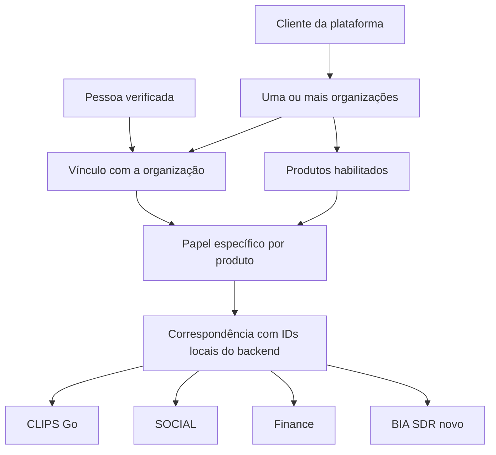

# Cadastro comum — CLIPS, SOCIAL, Finance e BIA/SDR

O diretório foi publicado no CLIPS Go de homologação no release `r-97a4bc6226ae`, em 06/11/2026. O workspace de teste da Bilhon está vinculado. A adoção obrigatória no login e a conexão com os outros backends aguardam ativação.

## O que foi implementado

O diretório atribui identificadores estáveis a clientes, organizações e pessoas. Uma pessoa pode participar de várias organizações, com papéis diferentes por produto. Nomes iguais não juntam clientes ou pessoas. E-mails, CNPJ, IDs enviados pelo navegador e códigos de demonstração não são usados para deduzir equivalência entre cadastros.

O vínculo é criado pelo operador a partir de referências verificadas da origem. Cada backend conserva seus IDs locais e seu banco; o diretório guarda a correspondência explícita. O mesmo pedido pode ser repetido sem duplicar IDs. Um pedido conflitante é recusado e revertido integralmente. Repetir o cadastro ou a migração não reativa acessos revogados.



O contrato retorna `customer_id`, `organization_id`, `person_id`, produto, backend, IDs locais e papel. Os papéis comuns são `viewer`, `operator` e `admin`. Eles limitam as permissões locais; um papel comum de administrador não promove um leitor local a administrador. Pertencer à organização não dá acesso automático a todos os produtos.

## Adoção nos produtos

| Produto | Implementação desta etapa |
|---|---|
| CLIPS Go | Adaptador opcional no login e nas consultas autenticadas; preserva conta, workspace e propriedade dos projetos. Papel comum de leitura recusa alterações. |
| FinanceAI Core | Adaptador opcional na autenticação, com interseção dos escopos financeiros locais. Os trabalhos iniciados por usuário conferem os direitos atuais na execução e na conclusão. |
| BIA/SDR novo (`sdr-next-pilot`) | Adaptador opcional no login e nas rotas autenticadas, incluindo agenda, mídia e dados do cliente. Preserva os perfis locais. |
| SOCIAL | Cadastro, habilitação, papel, vínculo de backend e cliente de consulta implementados e exercitados no laboratório. O aplicativo SOCIAL ainda precisa consumir esse contrato; sua interface de rascunhos não foi conectada nesta etapa. |

O SDR/BIA original em operação permanece fora da adoção. As automações existentes não foram reescritas. A revogação comum é verificada nas chamadas autenticadas; não desfaz efeitos já concluídos nem implementa um cancelamento geral das automações do SDR.

Cada produto continua autenticando sua própria sessão. O diretório recebe a identidade local já autenticada pelo backend, via credencial de serviço limitada à organização, ao produto e ao backend registrados. Nenhum token de usuário Finance é aceito automaticamente pelo CLIPS ou SDR. Login único e integração do portal/remix são etapas posteriores.

A etapa 2 acrescenta o catálogo de instalações e a jornada de entrada pelo remix do CLIPS Go. O backend está publicado em homologação. A ativação depende de um domínio verificado e a integração com o catálogo real Arkom continua pendente. [Entrada pelo remix](plataforma-entrada-remix.md).

## Contrato e proteção

`POST /integration/v1/identity/{solution}/resolve` exige credencial de serviço e `X-Organization-ID` correspondente à concessão cadastrada. O corpo contém somente `backend`, `local_organization_id` e `local_actor_id`. A rota recusa chamadas com `Origin` de navegador. Não expõe cadastro administrativo nem dados dos outros produtos.

Cliente, organização, pessoa, vínculo, produto e concessão precisam estar ativos. O desligamento de um produto também bloqueia o acesso desse serviço à API de eventos quando a verificação comum está habilitada. Alterações administrativas exigem revisão esperada e motivo; atualizações concorrentes antigas são recusadas e as mudanças ficam em auditoria.

Uma configuração ausente mantém a adoção desativada. Uma configuração presente, inválida ou indisponível bloqueia o acesso: não há retorno silencioso ao modo anterior. As verificações de identidade não usam cache de permissões entre pedidos.

O esquema `platform_directory` fica inicialmente no PostgreSQL exclusivo da homologação CLIPS, separado dos registros de negócio dos outros produtos, e acompanha o backup desse banco. O serviço HTTP usa a API de homologação. Ao ativar essa dependência em vários produtos, a disponibilidade desse serviço passa a fazer parte do acesso deles; a oferta geral exige planejar capacidade e disponibilidade próprias para o diretório.

## Ativação planejada

1. Publicar binário e migração adicional com a adoção desativada; verificar backup e retorno.
2. Levantar os IDs locais exatos das organizações e pessoas de cada instalação. Cadastrar seus vínculos pelo comando administrativo `directory-register`, com JSON pela entrada padrão. O cadastro existente pode ser adotado com `existing_organization_id`, preservando seu identificador.
3. Conferir a correspondência antes de ativar qualquer backend. Na adoção por backend, todas as contas habilitadas que devam continuar entrando precisam estar mapeadas. Um cadastro sem correspondência será recusado; não ativar parcialmente uma instalação compartilhada.
4. Criar ou reutilizar credenciais de serviço por organização/produto e vinculá-las ao backend por `directory-bind-service`. Guardar os arquivos privados fora do frontend, dos pacotes Remix e do Git.
5. Habilitar a API do diretório com `CLIPS_DIRECTORY_ENABLED=1`. A aplicação das regras ao acesso humano do CLIPS exige também `CLIPS_DIRECTORY_BACKEND` com o backend cadastrado. A atualização de releases preserva essas escolhas explícitas.
6. Finance usa `FINANCEAI_DIRECTORY_FILE`; o novo SDR usa `SDR_DIRECTORY_FILE`. O mesmo arquivo de cada produto deve estar disponível aos seus processos que validam permissões, inclusive os workers Finance. Esses arquivos devem ter permissão `0600` e ser montados com usuário compatível.
7. Testar cada instalação com duas empresas, leitura, alteração, revogação, falha de comunicação e retorno. Só depois liberar a instalação ao cliente.

Modelo do arquivo privado por backend, com valores ilustrativos:

```json
{
  "url": "https://diretorio.exemplo.invalid",
  "backend": "finance-homolog",
  "solution": "finance",
  "organizations": [
    {
      "organization_id": "UUID_COMUM_RETORNADO_PELO_DIRETORIO",
      "local_organization_id": "ID_LOCAL_VERIFICADO_NO_FINANCE",
      "token": "CREDENCIAL_PRIVADA_DESTE_SERVICO"
    }
  ]
}
```

O cadastro administrativo (`directory-register`), as mudanças com revisão (`directory-change`) e o vínculo de serviço (`directory-bind-service`) existem como papéis do binário CLIPS, executados pelo operador. Eles não foram disponibilizados ao navegador. O formato de cadastro está em `internal/platformdirectory/model.go`; as referências da origem e os IDs locais devem ser obtidos do ambiente correto antes da execução.

## Verificação reproduzível

```sh
python3 pilots/clips/verify-directory-local.py
```

O roteiro usa PostgreSQL e Auth descartáveis, serviços HTTP de teste e dados fictícios. Exercita o diretório com duas empresas e quatro produtos, pessoa em duas organizações, permissões distintas por produto, cadastro concorrente, conflito com rollback, revogação e isolamento. Também executa os testes dos adaptadores nas APIs reais de Finance e SDR, com o provedor de diretório simulado nesses testes específicos, além das suítes existentes e `go vet`. Não é um teste conjunto de todos os aplicativos publicados.

Evidências ficam em `.local/platform-directory/validation.json` e nos logs da mesma pasta. O cliente Go é mantido em `pkg/platformaccess` e copiado para os dois backends isolados com hashes de origem registrados. `python3 pilots/clips/sync-platform-access.py --check` detecta divergências. Nenhuma nova dependência de compilação em um caminho local foi acrescentada aos módulos Go.
