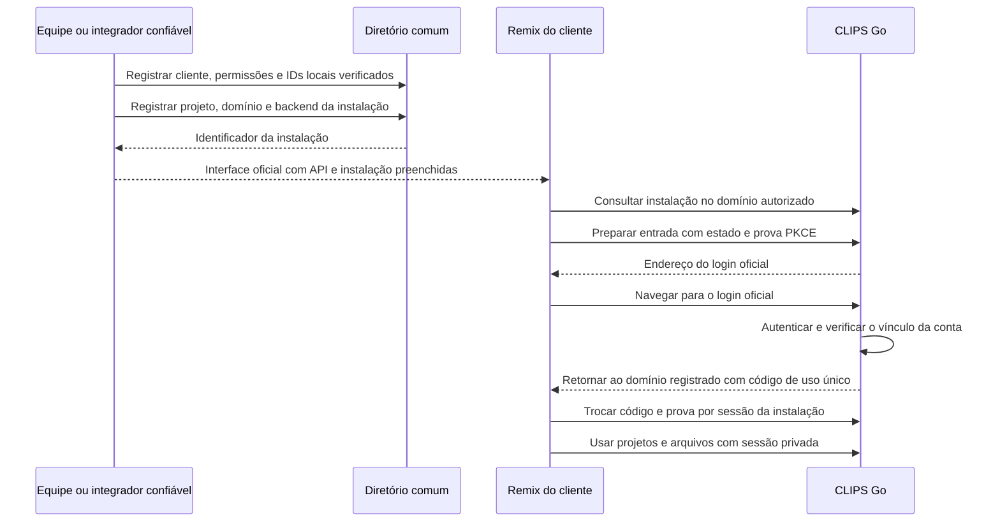

# Entrada pelo Remix — etapa 2

O backend e a interface oficial do CLIPS Go foram publicados em homologação em 06/11/2026, no release `r-97a4bc6226ae`. O pacote para o Remix foi validado em laboratório. A ativação externa depende do cadastro de um domínio verificado e da instalação correspondente. A integração com o catálogo real da Arkom continua pendente.

## Jornada entregue no código



O cliente não configura banco, Edge Functions ou chaves. O pacote leva somente `api_url` e `installation_id` em `public/clips-installation.json`. Prévia e publicação precisam de registros próprios quando usam domínios diferentes. Uma cópia em outro endereço é recusada pelo backend.

A tela oficial de login, os tokens, as fontes, os arquivos de marca e o tema foram preservados. As mudanças de interface são de autenticação e transporte de dados, no modo separado `clips-remix`; o build padrão continua com seu comportamento original. A prévia em quadro usa um botão do design system para abrir a instalação em nova aba. A tela de login oficial permanece protegida contra enquadramento.

## Escopo por solução

O catálogo comum de instalações aceita CLIPS, SOCIAL, Finance e BIA/SDR, com vínculo explícito ao backend e à organização registrados na etapa 1. A jornada de navegador desta entrega está implementada no CLIPS Go. Finance e SDR conservam seus mecanismos atuais de entrada; seus adaptadores do catálogo/remix e o aplicativo SOCIAL ainda precisam ser conectados. O novo catálogo não substitui automaticamente os cadastros de instalação internos desses produtos.

O portal real Arkom não foi modificado. O registro está disponível para operador por `directory-installation`, no mesmo binário do diretório. Um futuro adaptador do portal deverá chamar esse contrato após autenticar o responsável e verificar o vínculo do projeto. Não há autoinscrição pública que confie em domínio, organização ou e-mail enviados pelo navegador.

## Vínculo e autorização

O operador registra organização comum, backend, produto, origem HTTPS exata, endereço da API, referência do projeto e referência da verificação realizada. Essa referência registra a evidência do operador; o código não consulta a conta Lovable nem realiza uma prova DNS. A responsabilidade de verificar a propriedade continua com o integrador confiável.

O diretório impede atribuir o mesmo domínio a organizações diferentes. O endereço da API de um backend não é trocado silenciosamente durante outro registro. Cadastro repetido com mesma chave/conteúdo retorna o mesmo identificador; divergências são recusadas e revertidas. Instalações podem ser desativadas com revisão esperada e motivo, por `directory-change` com `kind: installation`. Repetir o registro não as reativa.

O login do cliente usa a autenticação já habilitada na interface oficial Go. Contas locais usam o cadastro próprio; contas de origem continuam usando a ponte com Supabase Auth. A etapa não copia senhas, não redefine acessos e não comprova a resolução do incidente original de credenciais.

O backend exige conta local habilitada, organização correta, correspondência no diretório e permissão ativa. O código temporário fica vinculado à instalação, ao estado e à prova PKCE S256. Só um pedido concorrente pode consumi-lo. O retorno sempre usa o domínio cadastrado e `/login`, sem endereço de redirecionamento livre fornecido pelo navegador.

As solicitações de entrada expiram em cinco minutos; o código de troca, em até um minuto. O código volta no fragmento e é retirado do endereço antes da troca. Access tokens duram até dez minutos; a sessão absoluta respeita o prazo do login Go que originou a entrada. Tokens de acesso e renovação ficam somente em memória no remix. O armazenamento da aba guarda apenas a prova temporária de entrada, sem senha ou token de sessão.

Recarregar realiza outra entrada pelo acesso oficial ainda válido. Ao expirar esse acesso, é necessário autenticar novamente. A saída do remix revoga a sessão e encerra o login CLIPS daquele navegador usado para abri-la, incluindo os remixes derivados desse mesmo login. Outros produtos e outros dispositivos mantêm suas sessões.

Cada chamada autenticada confere novamente instalação, origem, conta e concessão. A renovação gira a credencial; reutilizar uma credencial já consumida revoga a sessão. A sessão do remix não autoriza operações técnicas da equipe nem a API entre serviços. CORS aceita somente o domínio exato registrado, sem cookies entre sites ou origem genérica.

Vídeos são consultados com a credencial privada da sessão e transformados em URLs locais temporárias para reprodução/download. Tokens não são colocados nas URLs dos arquivos. A interface limita o cache local de vídeos e o remove na saída. Um arquivo já baixado não pode ser revogado remotamente.

## Preparação pela equipe

1. Conferir o cadastro do cliente e seus IDs locais na etapa 1. No CLIPS, preservar os identificadores de conta e workspace já verificados.
2. Verificar a relação entre cliente, projeto e domínio do remix. Registrar por entrada padrão no papel `directory-installation`. Endereços locais só são aceitos pelos testes; o comando operacional exige origem HTTPS de domínio não local.
3. Guardar o resultado do operador em arquivo privado e gerar a interface configurada:

```sh
python3 pilots/clips/package-remix.py --installation /caminho/privado/instalacao-verificada.json
```

4. Importar os fontes do pacote no projeto correspondente. O pacote fixa os comandos de build no modo `clips-remix` e mantém o guard do design system. Inclui instruções ao Lovable e não inclui Go, SQL, configurações privadas, banco, tokens ou senhas.
5. Publicar a atualização Go e a interface oficial do acesso central. Habilitar `CLIPS_REMIX_ENABLED=1` e `CLIPS_REMIX_BACKEND` com o backend cadastrado. A aplicação das regras de entrada do remix é independente da adoção global dos acessos antigos: contas antigas não são remapeadas por essa ativação.
6. Verificar login, recarga, projetos, renderização, reprodução, download, saída e recusa de outro domínio no endereço real antes de entregar ao cliente. O pacote é candidato até essa verificação.

O release publicado inclui o catálogo e as rotas de entrada. A entrada Remix está habilitada em homologação desde o release `r-12ffe2161022`. Cada projeto só ganha acesso depois de ter o domínio verificado e a instalação registrada. O backup do PostgreSQL inclui o diretório, as instalações e os registros de sessão, com hashes das credenciais.

## Verificações locais

```sh
python3 pilots/clips/verify-identity-local.py
python3 pilots/clips/verify-remix-local.py
```

O primeiro roteiro exercita o backend em PostgreSQL e Auth descartáveis. O segundo compila os modos `clips-go` e `clips-remix`, mantém todos os serviços em loopback e usa sites locais distintos em navegador real. O servidor e os cadastros são criados somente pelo teste; não existe configuração operacional para criar contas fictícias ou contornar o login.

O teste de navegador usa dados fictícios e um MP4 de exemplo. As evidências ficam em `.local/clips-remix-test`, incluindo o resultado, capturas e o corte gerado. O pacote candidato é validado separadamente por instalação limpa e build. Isso não comprova importação no Lovable real nem capacidade operacional de produção.

O escopo funcional do CLIPS continua sendo MP4 pequeno e corte manual: até 7 MiB, trecho de até 30 segundos e saída 720×1280. Vídeos maiores, transcrição, legendas automáticas, análise por IA e migração de histórico continuam nas próximas entregas.
