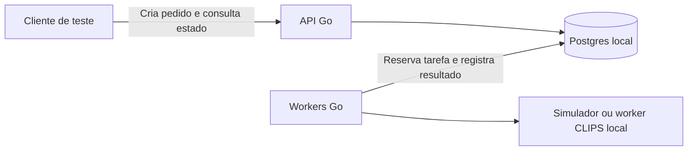

# Piloto local do CLIPS

**Interface oficial publicada:** [CLIPS Go em homologação](https://clipsgo-homolog.24-199-100-186.sslip.io/login). O build `clips-go` preserva o design system, usa o Auth central para identidade e o backend próprio para dados novos. Consulte o [escopo e a reprodução](../../docs/clips-go-interface-homologacao.md). Esta publicação tem upload de até 7 MiB e corte vertical manual de até 30 segundos; histórico, transcrição e IA não foram migrados.

O piloto recebe pedidos pela API Go, grava-os em uma fila no PostgreSQL 17 e processa até dois pedidos em paralelo. Pode usar o simulador ou chamar o worker de vídeo do CLIPS para cortar um vídeo sintético local.

## Testar a API local do CLIPS Go

Depois de preparar o FFmpeg com `./pilots/clips/prepare-video.sh`, inicie:

```sh
./pilots/clips/run-local.sh --studio
```

Esse modo expõe apenas a API em `http://127.0.0.1:18082`. Use `POST /studio/session` com `Content-Type: application/json` para receber um cookie de teste. Envie um formulário multipart em `POST /studio/jobs` com esse cookie, a chave `Idempotency-Key` e os campos `video`, `start`, `duration` e, opcionalmente, `captions`. O vídeo aceita MP4 ou M4V de até 48 MiB. O SRT usa tempos relativos ao corte. Consulte `GET /studio/jobs/{id}` e baixe o MP4 vertical em `GET /studio/jobs/{id}/video`. O Postgres separado fica em `.local/clips-go`.

A interface de referência é a do repositório oficial `Bilhon-OS/arkom-clips`, com o design system ARKOM. A API, o banco e o worker são desenvolvidos em paralelo. A sessão local serve somente para validar a API. Para entregar um endereço externo, ainda é necessário integrar a interface existente a um ambiente isolado com acesso por convite. A geração de legendas, a seleção automática de trechos e a importação do histórico ficam para outras etapas.



## Rodar um corte real no Mac

Com Go 1.26, PostgreSQL 17, `uv` e Python 3.13, execute na raiz do Arkon:

```sh
./pilots/clips/prepare-video.sh
./pilots/clips/run-local.sh --video
```

A preparação baixa o código do worker e as dependências fixadas e gera um vídeo sintético de 8 segundos com áudio e trechos vermelho, verde e azul. Se necessário, informe o caminho para o Python 3.13 com `CLIPS_PILOT_PYTHON`. O worker roda em um socket Unix privado. O adaptador local habilita somente a rota `/trim` para a receita fixa do vídeo sintético, redireciona os temporários para uma pasta privada e omite a dependência das rotas de rastreamento facial. O código de `/trim` vem do [commit fixado do worker CLIPS](https://github.com/Bilhon-OS/clips-ai-worker/blob/004ebac9caeb701efe993498179b9cf1c742e880/app.py#L755).

Em outro terminal, rode:

```sh
python3 pilots/clips/verify-video.py
```

O teste passa pela API, fila, worker de vídeo e Postgres. Confere que o pedido duplicado retorna o mesmo ID e que o MP4 tem 90 quadros verdes a 30 fps e três segundos de áudio. O arquivo é salvo em `.local/clips-pilot-video/clips-demo-2s-5s.mp4`. O estado e os MP4s dos pedidos ficam no Postgres desse modo. A API retorna o caminho de download em `result.download_path` quando o pedido conclui.

No modo de vídeo, `entrevista-demo` gera o MP4 real. Os cenários de falha continuam simulados. Execute um modo por vez, pois ambos usam a porta local 18082.

## Testar um podcast vertical com legenda

Depois de preparar o worker com `./pilots/clips/prepare-video.sh`, execute:

```sh
python3 pilots/clips/prepare-podcast.py
./pilots/clips/run-local.sh --podcast
```

Em outro terminal:

```sh
python3 pilots/clips/verify-video.py --podcast
```

A preparação usa um episódio publicado pela NASA/CXC, com o arquivo de origem conferido por SHA-256. A receita local seleciona 00:30,00–00:43,60, mantém a imagem inteira sobre um fundo desfocado, produz um quadro vertical de 720 × 1280 e envia ao worker a legenda em português como arquivo ASS. As legendas foram traduzidas e revisadas a partir da transcrição e alinhadas com marcações obtidas localmente. [The Universe Darkly, NASA/CXC](https://imagine.gsfc.nasa.gov/educators/programs/cosmictimes/universe_mashup/archive/pages/interview.html)

O verificador cria o pedido pela API, valida a deduplicação e confere dimensões, duração, áudio e presença da legenda no quadro. Salva o MP4 em `.local/clips-podcast/podcast-vertical-legendado.mp4`. O modo podcast usa um banco exclusivo em `.local/clips-podcast/postgres` e o mesmo worker local do modo sintético. O socket privado aceita apenas a receita preparada, com vídeo e legenda locais.

## Homologar a exportação do aplicativo

Prepare o modo podcast e inicie `./pilots/clips/run-local.sh --homolog-export`. Esse modo usa seu próprio Postgres em `.local/clips-homolog-export`. Em uma cópia separada de `Bilhon-OS/arkom-clips` com as dependências instaladas, copie `homolog-app.test.ts` para `src/test/` e execute:

```sh
npx vitest run src/test/homolog-app.test.ts
```

O teste roda o hook real `useExportClip` e substitui o cliente Supabase por um adaptador que fala apenas com o Go em `127.0.0.1`. O adaptador preserva a resposta HTTP 202 com `exportPath`, simula a consulta ao bucket e assina o download de um MP4 real. O servidor aceita uma sessão fictícia, uma organização, um projeto novo e um corte específico. Os pedidos fora do recorte retornam a indicação de caminho legado, cuja execução não faz parte do teste. A homologação local não usa autenticação nem Storage reais. O endpoint aceita uma receita fixa, inclusive o estilo de legenda, e serve para verificar o contrato antes de integrar um ambiente compartilhado.

Para testar pelo botão **Exportar** da tela oficial, inicie `./pilots/clips/run-local.sh --homolog-ui` no Arkon. Na cópia oficial do aplicativo, execute `npm run build` e `npx vite preview --host 127.0.0.1 --port 18083 --strictPort`. Use esse servidor somente pelo verificador. O aplicativo original contém o endereço do Supabase central e o bloqueio de rede vale dentro da sessão de navegador criada pelo teste.

```sh
node pilots/clips/verify-homolog-ui.mjs /caminho/da/copia/arkom-clips
```

O verificador carrega um projeto e um corte fictícios, usa os componentes e estilos do build oficial e intercepta as requisições ao Supabase antes que saiam do navegador. Auth, registros e Storage têm respostas locais. O pedido de exportação, a fila, a renderização e o download passam pelo Go e pelo worker reais. O teste cobre reenvio idempotente, outro projeto, outro corte, outro usuário e outra organização. O MP4 e a captura da interface ficam em `.local/clips-homolog-ui`. O teste valida a exportação rápida com a receita fixa do podcast. Criação de projeto pelo formulário, aplicação das escolhas do editor de legendas, execução do caminho legado e integração com o ambiente do cliente seguem fora do teste.

## Rodar o simulador no Mac

Com Go 1.26 e PostgreSQL 17 instalados, execute na raiz do repositório:

```sh
./pilots/clips/run-local.sh
```

Se o PostgreSQL estiver fora do caminho padrão do Homebrew para Apple Silicon, informe a pasta que contém `initdb`, `pg_ctl`, `psql` e `createdb` com `CLIPS_PILOT_PG_BIN`. A API escuta em `127.0.0.1:18082`. O launcher cria uma instância exclusiva do PostgreSQL em `.local/clips-pilot` e conecta pelo socket Unix privado. `Ctrl+C` encerra os processos. As tarefas e resultados persistem nessa pasta para a próxima execução.

Se um encerramento abrupto deixar `.local/clips-pilot/running`, confirme primeiro que o processo do piloto e seu Postgres pararam. Depois remova a pasta vazia `running` e inicie novamente.

## Testar pela API

Em outro terminal:

```sh
curl -fsS http://127.0.0.1:18082/healthz

curl -i http://127.0.0.1:18082/jobs \
  -H 'Content-Type: application/json' \
  -H 'Idempotency-Key: entrevista-001' \
  -d '{"fixture":"entrevista-demo"}'
```

O primeiro envio retorna `202 Accepted` e o cabeçalho `Location`. Consulte esse caminho com `GET` até o pedido chegar a `succeeded` ou `failed`.

```sh
curl -fsS http://127.0.0.1:18082/jobs/ID_DO_PEDIDO
```

Repetir a mesma chave com o mesmo cenário retorna o pedido original (`200 OK`). Reusar a chave com outro cenário retorna `409 Conflict`. Use uma chave nova para criar outro pedido.

| Cenário | Resultado esperado |
|---|---|
| `entrevista-demo` | Conclui na primeira tentativa |
| `retry-demo` | Falha uma vez e conclui na segunda |
| `falha-demo` | Encerra com erro após três tentativas |

Cada tentativa reserva a tarefa por dez segundos no simulador ou trinta segundos no modo de vídeo. Se o worker parar durante o processamento, outra execução pode recuperar a tarefa após o prazo. Quando a terceira tentativa expira, o pedido termina com `lease_expired`. O MP4 de até 10 MiB e o estado de conclusão são gravados na mesma transação. Para vídeos maiores e processamento mais longo, o desenho de produção precisa prever armazenamento de objetos e renovação da reserva.

O simulador gera metadados. Os modos de vídeo e podcast validam receitas de arquivos locais. Download do YouTube, enquadramento automático e login estão fora do escopo.

## Validar login real no ambiente local

A alteração proposta em `login-homolog.patch` cria o modo de build `clips-homolog` na cópia oficial do aplicativo. Ela exige um ambiente explicitamente configurado e bloqueia o ref central em homologação. O build padrão continua usando a configuração original. Nesse modo de teste a resolução de organização usa somente a instância indicada e distingue falha técnica de falta de vínculo. As telas e os estilos são os oficiais.

A cópia de trabalho desta sessão está em `.local/arkom-clips-login-homolog`, branch local `codex/clips-login-homolog`. Para reproduzir em outra cópia limpa, aplique `login-homolog.patch` a partir da raiz do repositório `arkom-clips` com `git apply /caminho/Arkon/pilots/clips/login-homolog.patch` e instale as dependências com `npm ci --ignore-scripts`.

Prepare o Auth oficial para macOS Apple Silicon e execute, na raiz do Arkon:

```sh
./pilots/clips/prepare-auth-local.sh
node pilots/clips/verify-auth-local.mjs /caminho/arkom-clips .local/clips-auth-lab
```

O teste usa PostgreSQL 17 e o Supabase Auth GoTrue v2.197.0, baixado da distribuição oficial com checksum conferido. Cria uma conta confirmada com senha aleatória num banco temporário e tenta entrar pela tela oficial. Confere rejeição de senha errada, entrada correta, recarga da sessão, instância esperada, distinção entre falha de consulta e ausência de vínculo e ausência do ref de produção no bundle de homologação. O processo exige as portas locais 18084, 18085 e 18086 livres.

A consulta de organização e os dados do dashboard usam respostas controladas pelo teste, após validação real do token no GoTrue. O gerador de remixes da plataforma não participa desse teste. A conta e o banco temporários são descartados ao fim. O resumo sem credenciais fica em `.local/clips-auth-lab/resultado-login-local.json`. Se precisar escolher um Chromium já instalado, use `CLIPS_TEST_CHROMIUM=/caminho/do/chromium`.

O teste de login local passou junto de 11 testes unitários de configuração e mensagens. Build, tipos e guard do design system também passaram. O conjunto de mudanças está pronto para revisão local. A publicação e a validação num remix realmente gerado pela plataforma seguem pendentes.

## Infraestrutura publicada

A primeira infraestrutura isolada está publicada para uso técnico da equipe. O [guia de operação](deploy/README.md) descreve HTTPS, acesso privado, limites, backup, recuperação e monitoramento. Login individual de clientes, remix publicado e fluxo completo permanecem nas etapas seguintes.
